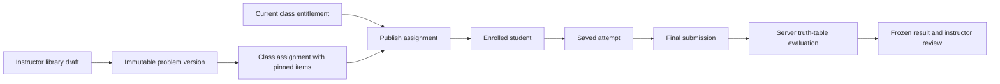
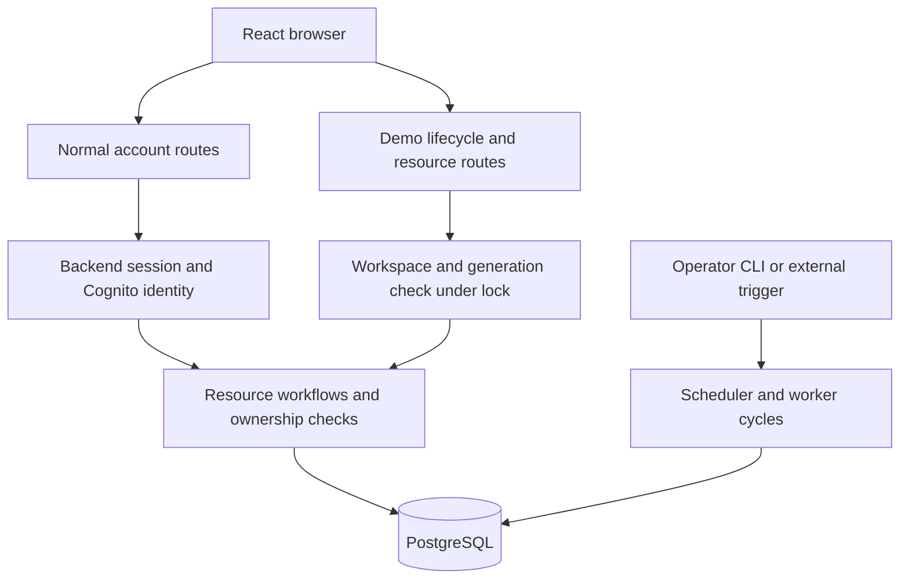

# Architecture overview

LogicLab is a TypeScript monorepo for teaching propositional logic. It implements anonymous truth-table practice, instructor-owned reusable problems and assignments, student submissions, simulated class payments, and operator jobs. The isolated demo reuses these workflows with disposable local identities. Application hosting is not yet deployed.

## Package boundaries

| Package              | Responsibility                                                                                 |
| -------------------- | ---------------------------------------------------------------------------------------------- |
| `apps/web`           | React pages, routing, account/demo state, and typed HTTP clients                               |
| `services/api`       | Fastify HTTP boundary, application workflows, provider adapters, persistence, and operator CLI |
| `tools/contracts`    | Shared Zod request/response validation and inferred TypeScript types                           |
| `tools/logic-engine` | Pure formula parsing, evaluation, and deterministic truth-table generation                     |
| `tools/db`           | MikroORM entities, field interfaces/enums, migrations, and database constraints                |

Contracts describe data crossing the API boundary; entities describe stored data and relationships. They intentionally differ: a database row can contain credentials, ownership, or expected answers that must never appear in its public response.

Within the API, `routes/` handles HTTP concerns, `application/` holds workflows and policies, `integrations/` adapts external systems, and `persistence/` implements database operations. `bootstrap/` assembles concrete dependencies. Small domains need no empty application layer solely for symmetry.

The web groups navigable screens in `pages/`, shared domain UI/state in `features/`, transport clients in `api/`, and layout in `components/layout/`. Hooks stay near their owners; shared request cancellation lives in `hooks/`. Route composition explicitly binds resource clients to normal or demo namespaces through a provider. The HTTP wrapper sends its supplied URL without inspecting browser location, and retained clients keep their original scope. Auth, demo lifecycle, and anonymous practice clients retain explicit endpoints. Frontend role guards guide navigation; the server independently enforces authorization.

## One assignment journey

Problem drafts remain editable; published versions preserve the content students were assigned. Assignment items reference versions rather than the current draft. Saved work remains editable until final submission; the server evaluates it and stores the final result. Feedback and solution access follow assignment policy. Initial assessment supports graded work with feedback on submission; instant feedback and completion-only modes remain future work.

A current entitlement gates new assignment publication. Existing published work remains accessible after coverage expires or is revoked. Purchases record the transaction and saved terms; entitlements express access. This separation leaves room for future institutional subscription funding. Current checkout is simulation only.

## Normal accounts and isolated demos

Normal email/password identities are managed by Cognito. The browser receives an opaque HttpOnly session cookie; encrypted provider tokens stay on the backend. Demo identities are explicit local users without Cognito identifiers or email, reached through a separate cookie and API namespace.

Each demo visitor owns a workspace containing synthetic instructor/student users and related data. Switching roles selects the other user in that workspace; it does not grant a normal user another role. Reset locks the workspace, replaces its graph, increments generation, and rotates the credential. Resource operations validate that generation and run inside the same workspace transaction, preventing a late write from repopulating reset data.

The database retains immutable publications, submitted attempts, and financial history for normal records. Narrow demo deletion guards and ownership checks permit reset/cleanup only for the identified disposable graph. Shared catalog plans and historical reconciliation findings remain retained.

## Operational work

The operator CLI invokes bounded scheduler/worker cycles. Schedules start disabled. Jobs and per-attempt history persist in PostgreSQL; concurrent claims use row locks, leases, and lease tokens. Finalization rejects stale workers. Billing reconciliation reports inconsistencies without repairing them.

Demo cleanup removes one bounded batch of expired workspaces. Expiration denies access immediately, independently of physical deletion. Cleanup is idempotent, but its deletion transaction and job-history finalization are separate: interruption between them can leave incomplete removal counts. JavaScript cancellation is cooperative; database wait limits and transaction abort checks bound cleanup work. External automation must invoke cycles explicitly; API startup runs no background timer.

## Deliberate tradeoffs and current limits

- PostgreSQL holds both product data and the durable queue, avoiding another service while preserving transactions. Claims are short transactions; demo resource/reset operations hold a workspace lock longer to prioritize isolation.
- Runtime Zod validation complements TypeScript, which cannot validate untrusted network data. ORM decorators, exact field checks, and database constraints cover different forms of drift.
- The pure logic engine is shared by practice and grading, keeping deterministic logic independent of HTTP, React, and storage.
- The demo creates a separate graph per visitor instead of sharing mutable demo accounts. This costs storage, so admission capacity, expiry, and cleanup are required.
- Tests cover pure logic, HTTP handlers/routes, React behavior, and real PostgreSQL invariants/concurrency. Local browser walkthroughs are evidence, not a browser CI suite.
- Public hosting, installed scheduling triggers, shared rate limiting, real payments, institutions/subscriptions, an admin interface, and derivation exercises remain outside the implemented release.

See [codebase conventions](../conventions/codebase-conventions.md) for implementation rules, [data design](../planning/data-design.md) for entity decisions, and [public demo setup](../development/public-demo.md) for local operation.
