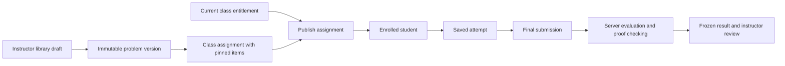
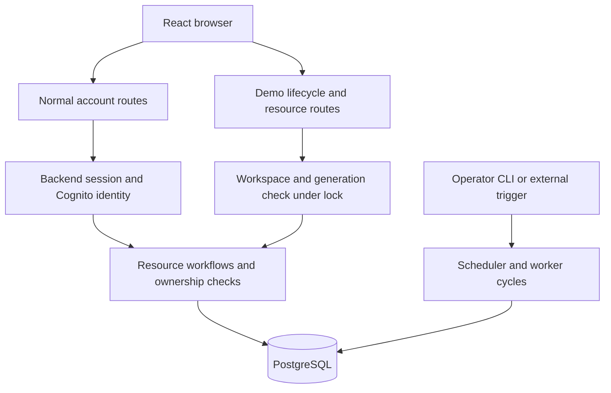

# Architecture overview

LogicLab is a TypeScript monorepo for teaching propositional logic. It implements anonymous truth-table and derivation practice, instructor-owned reusable problems and assignments, student submissions, simulated class payments, and operator jobs. The isolated demo reuses these workflows with disposable local identities. Application hosting is not yet deployed.

## Package boundaries

| Package              | Responsibility                                                                                 |
| -------------------- | ---------------------------------------------------------------------------------------------- |
| `apps/web`           | React pages, routing, account/demo state, and typed HTTP clients                               |
| `services/api`       | Fastify HTTP boundary, application workflows, provider adapters, persistence, and operator CLI |
| `tools/contracts`    | Shared Zod request/response validation and inferred TypeScript types                           |
| `tools/logic-engine` | Pure formula parsing, evaluation, truth tables and standalone propositional proof checking     |
| `tools/db`           | MikroORM entities, field interfaces/enums, migrations, and database constraints                |

Contracts describe data crossing the API boundary; entities describe stored data and relationships. They intentionally differ: a database row can contain credentials, ownership, or expected answers that must never appear in its public response.

Within the API, `routes/` handles HTTP concerns, `application/` holds workflows and policies, `integrations/` adapts external systems, and `persistence/` implements database operations. `bootstrap/` assembles concrete dependencies. Small domains need no empty application layer solely for symmetry.

The web groups navigable screens in `pages/`, shared domain UI/state in `features/`, transport clients in `api/`, and layout in `components/layout/`. Hooks stay near their owners; shared request cancellation lives in `hooks/`. Route composition explicitly binds resource clients to normal or demo namespaces through a provider. The HTTP wrapper sends its supplied URL without inspecting browser location, and retained clients keep their original scope. Auth, demo lifecycle, and anonymous practice clients retain explicit endpoints. Frontend role guards guide navigation; the server independently enforces authorization.

## One assignment journey

Problem drafts remain editable; published versions preserve the content students were assigned. Assignment items reference versions rather than the current draft. Saved work remains editable until final submission; the server evaluates it and stores the final result. Assignment policy supports graded, completion-only and private practice workflows. Proof checks remain explicit; graded diagnostics and reference access follow their independent release rules.

A current entitlement gates new assignment publication. Existing published work remains accessible after coverage expires or is revoked. Purchases record the transaction and saved terms; entitlements express access. This separation leaves room for future institutional subscription funding. Current checkout is simulation only.

## Normal accounts and isolated demos

Normal email/password identities are managed by Cognito. The browser receives an opaque HttpOnly session cookie; encrypted provider tokens stay on the backend. Demo identities are explicit local users without Cognito identifiers or email, reached through a separate cookie and API namespace.

Each demo visitor owns a workspace containing synthetic instructor/student users and related data. Switching roles selects the other user in that workspace; it does not grant a normal user another role. Reset locks the workspace, replaces its graph, increments generation, and rotates the credential. Resource operations validate that generation and run inside the same workspace transaction, preventing a late write from repopulating reset data.

The database retains immutable publications, submitted attempts, and financial history for normal records. Narrow demo deletion guards and ownership checks permit reset/cleanup only for the identified disposable graph. Shared catalog plans and historical reconciliation findings remain retained.

## Operational work

The operator CLI invokes bounded scheduler/worker cycles. Schedules start disabled. Jobs and per-attempt history persist in PostgreSQL; concurrent claims use row locks, leases, and lease tokens. Finalization rejects stale workers. Billing reconciliation reports inconsistencies without repairing them.

Demo cleanup removes one bounded batch of expired workspaces. Expiration denies access immediately, independently of physical deletion. Cleanup is idempotent, but its deletion transaction and job-history finalization are separate: interruption between them can leave incomplete removal counts. JavaScript cancellation is cooperative; database wait limits and transaction abort checks bound cleanup work. External automation must invoke cycles explicitly; API startup runs no background timer.

## Deliberate tradeoffs and current limits

- PostgreSQL holds both product data and the durable queue, avoiding another service while preserving transactions. Claims are short transactions; demo resource/reset operations hold a workspace lock longer to prioritize isolation.
- Runtime Zod validation complements TypeScript, which cannot validate untrusted network data. ORM decorators, exact field checks, and database constraints cover different forms of drift.
- The pure logic engine is shared by practice and grading, keeping deterministic logic independent of HTTP, React, and storage.
- The demo creates a separate graph per visitor instead of sharing mutable demo accounts. This costs storage, so admission capacity, expiry, and cleanup are required.
- Tests cover pure logic, HTTP handlers/routes, React behavior, and real PostgreSQL invariants/concurrency. Local browser walkthroughs are evidence, not a browser CI suite.
- Public hosting, installed scheduling triggers, shared rate limiting, real payments, institutions/subscriptions, and an admin interface remain outside the implemented release. Fitch, dependency and tree graded, practice and completion-only proof assignments are supported.

See [codebase conventions](../conventions/codebase-conventions.md) for implementation rules, [data design](../planning/data-design.md) for entity decisions, and [public demo setup](../development/public-demo.md) for local operation.

## Standalone proof-checker foundation

`@logiclab/logic-engine/proof` provides the versioned propositional catalog, proof-only parsing and deterministic Fitch/dependency/tree checkers. It separates structural scope/reference checks, local inference patterns, upstream support and whole-proof acceptance. The public entry validates bounded input and returns versioned reports; unused errors require review even if an independent target is established. Contracts define serialized proof/report shapes, while the engine owns reasoning. Application callers supply authoritative pinned problems and enforce ownership, grading and disclosure separately.

Private instructor authoring checks reference proofs before publication. Student practice and completion workflows use pinned redacted statements, revisioned explicit saves and separate reference-reveal authorization. Practice checks are explicit; completion requires a finished attempt and freezes post-submission diagnostics without points. Instructor review exposes final submissions and retained proof diagnostics. Accepted graded proofs receive full automatic points; others need instructor review. Separate append-only grading revisions retain point/comment adjustments without changing final answers, reports or automatic scores. Owner lists and released student views use the latest effective points; unresolved totals stay null. Grade release controls reports/comments, while answer reveal controls references. See [design](../planning/propositional-proof-checker.md) and [verification](../verification/propositional-proof-checker-verification.md).

See [student-work boundaries and transactions](../planning/derivation-student-work.md) and [verification](../verification/derivation-student-work-verification.md) for the delivered paths, disclosure rules and limits.

Instructor grading is assembled explicitly as `context.submissionGrading` alongside `context.submissionReviews` and `context.assignments`. Normal and demo stores use the same persistence implementation; demo requests bind them to the workspace transaction and authenticated actor. Current grading is the latest retained revision, and review pages fetch only the latest revision per final submission rather than entire histories. See [grading/review implementation](../planning/derivation-grading-review.md) and [focused verification](../verification/derivation-grading-review-verification.md).

### Format-specific proof structure

Natural-deduction trees use flat UUID-identified nodes with a selected conclusion root, premise/assumption leaves and inference child references. Every use is a separate occurrence: sharing a node between branches is invalid. The tree adapter walks iteratively, checks connectivity/cycles and tracks open assumption occurrences. Discharge removes only explicitly selected matching open leaves from its own supporting branch; repeated and vacuous discharge are supported. A matching root is established only with valid support and no remaining temporary assumptions. The editor draws supports above their conclusion without checking correctness; explicit checks and released frozen reports supply diagnostics. See [tree representation and verification](../verification/natural-deduction-trees-verification.md).

The engine groups structural/input/step logic under `proof/fitch/`, `proof/dependency/` and `proof/tree/`. Formula parsing/equality, local rule patterns, deterministic budgets, diagnostics and report construction remain shared. Dependency checking derives support from authoritative premises/assumptions and computed earlier support, compares written sets exactly and discharges only the assumption belonging to each cited branch. An established final dependency target may contain only stated-premise support; unused errors still prevent acceptance. Completion readiness is a separate predicate and does not require correctness.

Application authoring uses matching `problem/derivation/fitch/`, `dependency/` and `tree/` helpers. Shared projections and student evaluators dispatch by the pinned server format. Normal/demo stores retain their existing authorization, transaction, revision and disclosure boundaries. There is no conversion through Fitch, separate inference catalog, schema migration or replacement grading model. The existing `/proof`, `/proof/rules` and `/proof/completion` package entries remain available. See [dependency verification](../verification/dependency-proof-format-verification.md).

## Independent proof practice

Public `/practice/proofs` lazy-loads page-owned setup and session state. It reuses the three student proof editors and bounded engine checkers locally, without a resource API client or private instructor definition. Premises/target/rules are fixed after starting; checking is explicit and feedback clears on edits. Confirmed format changes and Start over remount a blank setup and discard all prior work. This page has no account/database save or browser-storage persistence; shared unsaved-work guards warn before loss where supported. Syntax validation does not promise that the chosen target is solvable. Assigned work retains separate server-side authorization, pinned content, saves, grading and disclosure.
