# UI/UX audit: baseline and proposed work

Run: **UI-029-001**, November 9, 2026. Branch: `029-chore-ui-ux-audit`. Baseline checkout: `97a0db3`. The baseline slice inventoried presentation without changing application code. Subsequent implementation and verification are recorded below; findings remain open unless explicitly resolved.

## Agreed direction and working targets

The user accepted a calm, clean academic direction: readable typography, restrained color, clear workspace navigation and meaningful action hierarchy. Keep the existing teal/slate/neutral palette as a starting point, system fonts, and textual correctness/verification signals. Avoid a wholesale component-library migration. Desktop is primary; mobile must remain usable.

Chrome is the initial baseline. The user's everyday browser was not specified. Safari is available locally but was not exercised; schedule a secondary-browser spot check when feasible. These working accessibility targets guide implementation and verification, not a conformance claim:

- Complete core tasks by keyboard, with visible focus and predictable focus after dialogs, added proof lines and navigation.
- Provide meaningful control labels, grouped choices, associated help/errors and understandable loading/status announcements.
- Keep correctness, pending review and destructive actions understandable without relying on color.
- Check text/control/focus contrast, reduced motion, 200% zoom and narrow layouts during the implementation passes.
- Use 1440×1000 desktop and 390×844 mobile baselines, then include a shorter desktop viewport and 320px/zoom stress checks before closeout. Necessary proof/table scrolling should stay within its content area.

## Baseline evidence and boundaries

Captured **49 route/state combinations** at both baseline widths, plus selected scrolled content and proof-row comparisons: **125 screenshots** retained locally under `.codex-local/ui-audit/029/baseline/`, with `inventory.json`, scripts and logs. Representative images below are tracked and were visually inspected alongside the source review. Headless Chrome was **156.0.8078.81**. No document-wide horizontal overflow was observed at 390px in those captured states; this does not establish large-proof, long-content or full responsive coverage.

Demo/public views used real local APIs and an isolated disposable PostgreSQL schema. Saved/final/released examples were prepared through public APIs to expose review states. Normal-account shell views used a synthetic auth-session response and read-only normal GETs mapped to that isolated demo graph. Login/recovery presentation included labeled session/reset/error fixtures; no live Cognito/email flow was exercised. A held class request and an injected 503 expose loading/error views. These fixtures are presentation evidence, not normal authentication, authorization or email verification.

Initial capture attempts needed script corrections for the normal-account interception boundary and a student heading. Valid initial captures were retained; the supplemental run completed the remaining views. Final records report no uncaught page errors. Temporary servers and schemas were removed after each attempt. No user development database or external service was changed. This is not an end-to-end QA sign-off.

## Prioritized findings

| ID       | Priority                                  | Finding                                                                                         | Evidence                                                                                     | Proposed response                                                                                        |
| -------- | ----------------------------------------- | ----------------------------------------------------------------------------------------------- | -------------------------------------------------------------------------------------------- | -------------------------------------------------------------------------------------------------------- |
| UI029-01 | High                                      | Proof-row styling depends on navigation history.                                                | AN05, AN10; CSS01/CSS02 comparison below.                                                    | Move shared card styles to their actual shared owner; verify direct and SPA visits match.                |
| UI029-02 | High, required before deployment          | Proof entry exposes the editable storage structure before a clean growing proof.                | AN05–AN07, ST06–ST08; existing agreed redesign.                                              | Prototype dependency proof display plus next-line entry first, then Fitch and tree interactions.         |
| UI029-03 | Medium                                    | Reference authoring and review require excessive vertical scanning.                             | IN05–IN07, IN14.                                                                             | Separate primary editing/review tasks from rule configuration, history and advanced controls.            |
| UI029-04 | Medium                                    | Workspace identity competes with site links, and the mobile header consumes substantial height. | IN01, NO01, NO03; earlier user finding.                                                      | Strengthen role/workspace treatment while retaining distinct site/workspace navigation.                  |
| UI029-05 | Medium                                    | Form controls and ordinary links lack one consistent visual treatment.                          | IN05, IN14, AN05; shared/global CSS inspection.                                              | Establish shared field/link/textarea styles and spacing with explicit checkbox/radio exceptions.         |
| UI029-06 | Medium                                    | Several editing, primary workflow and destructive actions have similar emphasis.                | AN05–AN07, DE01, IN14; proof deletion controls.                                              | Define primary/secondary/quiet/destructive variants and apply them by task.                              |
| UI029-07 | Medium                                    | Long instructional text precedes the working area and repeats across layers.                    | AN05, ST07, IN05–IN07.                                                                       | Keep essential task/release guidance visible; move detailed mechanics into contextual help/disclosures.  |
| UI029-08 | Small navigation fix                      | Proof practice has no current-page cue on the global Practice link.                             | AN05; root Practice link uses exact matching.                                                | Make the Practice section identifiable across table/proof routes without duplicating the top-level link. |
| UI029-09 | Verification gate, not a diagnosed defect | Keyboard, contrast, zoom, assistive-technology and secondary-browser coverage is incomplete.    | This slice is observational; source review confirms some existing accessibility foundations. | Run the agreed checks as each shared/domain interaction changes and record outcomes/limits.              |

### UI029-01: confirmed route-dependent styles

The proof editors use `.problem-option`, whose border/padding/margin are defined only in [problem-library.css](../../apps/web/src/pages/problem-library/problem-library.css). That stylesheet belongs to the lazy-loaded owner-library page. On a fresh direct visit to proof practice, a premise row has `0px` border, padding and margin. Visit the library, then return through SPA links and build the same proof: it has `1px` border, `12px` padding and `12px` margin. Computed styles and element screenshots confirm the difference; the proof data and viewport are equivalent.

Direct visit:

After loading the library stylesheet through navigation:

The first implementation slice should correct ownership of genuinely shared presentation before layering new visual rules on top. Inspect `.correct-option` and other reused selectors for similar ownership issues; do not simply import an unrelated page stylesheet into every proof component.

### UI029-02/03/07: make the proof the focal point

Independent practice currently places setup/reset explanations, statement details and editor instructions before line controls. The dependency authoring example IN06 had 81 form/action controls in the DOM and a 9,486px document at 390px width; disabled/collapsed controls are included in that count. IN14's pending grading/review page was 7,854px tall. These are observations of seeded examples, not permanent thresholds or test assertions.

Use a compact proof display that grows as entries are confirmed, with a focused entry/edit area. Keep stable identities, unresolved references, incomplete drafts, explicit checking/saving and independent release rules. Add line is an editing action, not a correctness check. For trees, use deliberate branch/node construction instead of a numbered-line form. Cover instructor references, assigned student work and self-created practice together.

One decision to settle with the first prototype: how pending entry fields interact with Check, Save and final submission. A practical candidate is to require explicit entry confirmation or discard before those actions, while retaining pending text and marking it unsaved. Confirming must still allow the incomplete/incorrect draft states supported by the existing workflow; it must not add hidden grading diagnostics. This candidate is not an implemented policy decision.

### UI029-04/05/06: shared foundations

On IN01 at 390px, the main content begins approximately 382px down a viewport of 844px. The existing two-level navigation is meaningful, but the role title and workspace links need stronger grouping with less vertical overhead. Keep normal/demo boundaries and the visible synthetic-data notice.

Normal instructor shell, using the explicitly synthetic auth/data fixture:

[global.css](../../apps/web/src/styles/global.css) gives inputs/selects/buttons a shared font and radius, while textareas receive partial per-page rules. The grading view exposes browser-default textarea/fieldset borders beside styled inputs. Ordinary content links can remain browser blue while navigation links are teal. Normalize these differences deliberately, without applying text-input widths to radios/checkboxes or flattening meaningful choice groups.

Keep one clear primary action per working region; make supporting controls quieter and destructive confirmation distinguishable. Existing secondary buttons, visible focus outlines, labels, policy-help associations, semantic reports and reduced-motion-aware scrolling are useful foundations to retain.

## Representative visual direction

Start with the instructor Classes screen as the shared-shell reference, then check the same treatment against student work and proof practice:

- A compact site header, followed by a clearly labeled instructor/student workspace band and obvious active destination.
- A concise page title and task summary, then separated list/editor regions. Use wider space for proof/table work and narrower readable text/form measures where appropriate.
- Existing deep teal for primary actions, slate text, quiet neutral surfaces and consistent borders/radii. Keep green/rose correctness states accompanied by words/symbols.
- A small spacing/type scale shared by labels, help, fields, panels and action rows. Textareas should look related to inputs; ordinary links should follow one recognizable treatment.
- Progressive disclosure for extended rule/reference instructions, history and less common controls. Preserve required release/privacy information at the action where it matters.

This is a proposed application of the agreed direction, not a new stylesheet or final mockup. Capture an implemented representative screen for review before propagating it broadly.

## Proposed implementation order

1. Fix shared-style ownership and introduce the field/link/action foundations; validate direct entry versus SPA navigation.
2. Apply the compact site/workspace shell to Classes as the representative screen, then verify instructor/student/demo and mobile variants.
3. Prototype the dependency proof display/entry workflow and settle pending-entry semantics; extend to Fitch and tree editing, references and retained review in focused slices.
4. Refine library/rule authoring, assignment selection/settings, student results, instructor grading, billing and account/error states using the shared patterns.
5. Run focused keyboard/focus, contrast, zoom/reduced-motion, short-screen/mobile and secondary-browser checks; close or explicitly defer findings and capture before/after evidence.

Remaining baseline gaps include archive/restore views, zero-enrollment/empty-library variants, denied/expired sessions, save-conflict/uncertain-write states, larger proofs/formulas, full keyboard traversal, zoom/reduced motion and Safari. Include them in subsequent focused work rather than implying that the captured matrix is exhaustive.

## Implementation: shared foundations

**UI-029-002**, November 9, 2026:

- **UI029-01 resolved:** move `.problem-option` from the lazy library stylesheet into the always-loaded shared stylesheet. Fitch, dependency and tree editors now receive the same border, padding and margin on direct entry and after SPA navigation through the library. `.correct-option` remains library-owned because its consumers are library fields.
- **UI029-05 partially addressed:** give textareas shared font/radius/border/padding, readable text/background and vertical resizing; unify ordinary content-link colors. Exclude radios/checkboxes from text-input sizing and padding, preserving compact native controls. Page-specific fieldset/layout refinement remains open.
- **UI029-06 partially addressed:** add an outlined destructive button variant for proof-deletion confirmations, unsaved-work discard and demo reset. Make End demo secondary. Labels, safe-action autofocus, cancellation and workflow behavior are unchanged. Broader editing/primary action hierarchy remains open for subsequent screen slices.

The Classes/workspace shell follows below. Proof entry redesign and the broader audit remain pending. No backend, assessment policy, persistence or transport changes are included.

After the shared-style fix, direct entry matches the previously styled library-navigation case:

Destructive emphasis keeps the labeled safe action and native dialog behavior:

Validation: all **402 web tests** passed; the web production build (including TypeScript checking) passed. Focused real-API Chrome checks captured ten desktop/mobile states, comparing direct and library-warmed proof cards in all three formats, exercising deletion cancellation, checking native choice-control sizing and shared textarea styling, and verifying dialog Tab/Escape/Stay/Discard behavior. The final successful run had no uncaught page errors or document-wide overflow at 390px. Temporary servers and the isolated test schema were cleaned up. Scripts, screenshots and computed-style evidence are retained under `.codex-local/ui-audit/029/shared-foundations/`.

Changed-file formatting, whitespace and local Markdown targets passed. Backend/database suites were not repeated for this presentation-only change. These focused checks do not establish full keyboard/focus containment, contrast, assistive-technology, zoom or secondary-browser coverage.

## Implementation: Classes and workspace shell

**UI-029-003**, November 9, 2026:

- **UI029-04 implemented for representative review:** use a shared deep-teal workspace surface with explicit instructor/student identity and a filled, underlined active destination. Demo mode retains its badge, synthetic-data/no-charge notice and lifecycle-control link. Preserve normal/demo destination scoping, role visibility and session-expiry removal.
- Reduce shared header/main spacing and allow workspace links to wrap. On the captured 390px instructor demo, main content begins around 314px instead of the baseline 382px; this is an observation, not a layout test threshold.
- Separate the Classes page heading, create/join form and owned/enrolled list. Desktop uses a narrow form beside a wider list; layouts below 800px stack them in reading/tab order. Keep account forms at their existing narrower measure. Add a visible Join a class heading for students.
- Preserve creation, invitations, joins, pagination, reload and status/error handling. Shared shell spacing also affects other pages; dense proof/library/review interactions remain scheduled for later slices.

Representative desktop screen:

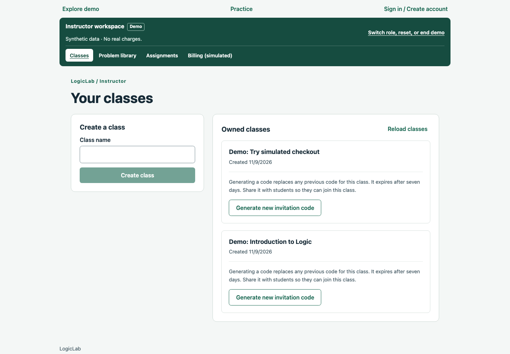

The same screen at 390px:

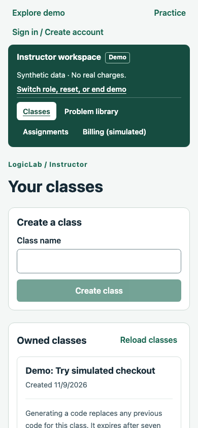

Validation: **402 web tests** and the web production build passed. Header regressions now assert role identity and the retained demo warning/badge; the six header cases passed again after those assertions were added. Focused Chrome checks captured ten desktop/mobile states covering both roles in demo and normal shells, anonymous practice, library, assigned work and class error/retry. Demo mutations used real local APIs: class creation cleared the form, invitation generation returned a code, reload retained the class, and a failed join retained entered text. Keyboard Tab/Enter navigation retained the correct destination and current-page marker. The 320px and 1024×600 checks had no page-wide overflow; no uncaught page errors were recorded. Normal-account views used the explicitly synthetic session/read-only data forwarding described above, not live Cognito or normal authorization verification.

Final evidence is in `.codex-local/ui-audit/029/workspace-shell/`; temporary servers/schema were cleaned up. Changed-file formatting, whitespace and local Markdown targets passed. Backend/database suites, full keyboard/assistive-technology/contrast/zoom checks and secondary-browser coverage were not repeated or established by this slice. The next planned slice is the dependency proof display/entry prototype, including an explicit decision about pending entry fields before Check, Save or Submit. Broader navigation work and final visual approval remain open.

## Implementation: dependency display foundation

**UI-029-004**, November 9, 2026: begin UI029-02 with a compact entered-proof table and a single selected line's controls, shared by dependency reference authoring, student work and independent practice. Show entered formulas, explicit dependency sets, effective rule labels, citations and discharges without interpreting them as checker results. Edit selects work without changing it; selection follows stable identities through moves. Missing references remain visible after deletion. Put the longer mechanics explanation behind a disclosure. Scoped table styles keep necessary horizontal scrolling inside the proof region and avoid dependence on truth-table stylesheet load order.

This is an intermediate foundation, **not the requested QA-ready prototype yet**. Existing line edits still update the current proof immediately, and the existing Add buttons still insert incomplete lines directly. Confirmed new-line entry, pending-entry dirty state/action gating, focus/announcements and final interaction polish follow in the next slices. No independent unsaved entry buffer has been introduced here, so existing saving/checking/submission behavior remains authoritative.

Validation: **405 web tests** and the web production build passed. Three new editor regressions cover nonmutating selection/raw invalid edits, identity-preserving moves/deletions, and incomplete insertion without retargeting existing references. Existing authoring tests now explicitly select the desired line. Focused Chrome practice smoke verified an explicit accepted check, feedback invalidation after edits, retained raw invalid input, one-line selection, scoped styles after truth-table navigation and local horizontal scrolling at 390px/320px without page-wide overflow. No page errors were recorded; temporary servers/schema were cleaned up. Local evidence: `.codex-local/ui-audit/029/dependency-display/`. Broader authoring/student browser QA, full keyboard/focus and accessibility/browser coverage remain pending; backend/database suites were not repeated.

## Implementation: confirmed dependency entry and first QA checkpoint

**UI-029-005**, November 9, 2026: new premise/assumption/inference entry now stays in a local buffer until **Add line**. **Discard entry** leaves the entered proof unchanged. Confirmation permits unfinished or logically incorrect work; it never invokes the checker. Existing-line edits still update the current proof directly and require the existing explicit save in persisted contexts.

Pending entry hides earlier check feedback and blocks Check, Save, Preview and final submission in the relevant hosts. Library pending entry marks even a clean saved draft dirty and prevents type/format replacement; assigned work registers pending entry with navigation/unload protection and confirms changing problems. Stay retains the entry; explicit discard permits the transition. Practice retains its existing session-wide unsaved protection. Entry fields receive focus when opened; Add/Discard returns focus to the initiating control and announces the editing outcome. An externally replaced proof cannot be overwritten by an entry based on older work.

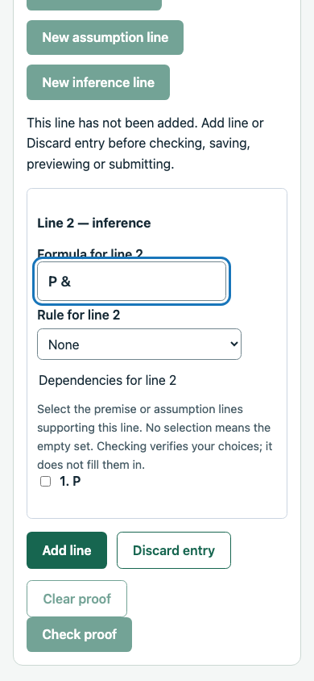

Validation: **411 web tests** and the web production build passed. Added coverage for pending dirty state, action gates, final submission, Stay/Discard across problem changes, focus restoration and stale-base protection. Focused Chrome smoke covered practice, private reference authoring and assigned dependency work against real local APIs: confirmation/discard, old-feedback hiding, protected navigation, explicit verification and persisted student saves. The 390px/320px checks had no document-wide overflow; no page errors were recorded. Temporary servers/schema were cleaned up. Final evidence: `.codex-local/ui-audit/029/dependency-entry/`. Formatting, whitespace and local Markdown targets passed. Graded submission gating was verified in tests, not a new browser finalization journey. Full accessibility/keyboard/browser coverage and broader product QA remain open; backend/database suites were not repeated.

**Ready for the user's first dependency-editor QA pass.** This is the interaction prototype, not final visual approval or completion of UI029-02. Fitch and tree editors retain their previous entry behavior.

Suggested quick review:

1. Open `/practice/proofs`, choose **Dependency**, add premise `P` and conclusion `P`, then choose **Begin proof practice** to open the proof directly.
2. In the bottom entry row, enter `P`, select **Reiteration**, cite line 1 and select line 1 in the dependencies dropdown. The proof display should still contain only the original premise.
3. Choose **Add line**. The new line should appear in the proof; choose **Check proof** separately to verify it.
4. In the next blank row, enter `P &`. Checking should be unavailable until Add/Discard; discarding should leave the entered proof unchanged. Adding an unfinished line should be allowed without automatic correctness feedback.
5. Open **⋯** on an earlier line and choose **Edit**, move lines and try a confirmed deletion. Review whether the display, line controls and unresolved references are understandable.
6. Optionally inspect `/demo/library` with **Conditional identity — Dependency**, and `/demo/work` with **Practice proofs in three formats**. Pending entry should block saving/checking; Stay on navigation should preserve it. Persisted work still requires an explicit save after Add line.

## Implementation: exact rule references and proof keyboard guidance

**UI-029-006**, November 9, 2026: user QA exposed that familiar rule names did not communicate exact accepted variants. Add an expandable **Rule reference** in Fitch, dependency and tree editors, plus help beside the selected inference rule. Show only the configured enabled rules, using instructor labels alongside catalog names/aliases. Each of the 19 catalog-v1 entries includes abstract formula/assumption patterns, exact ordinary/discharge reference counts, variant restrictions and a worked example rendered for the current format. Examples use Fitch subproof marks, dependency sets/discharge pairs or tree branches/assumption labels. They are fixed instructional examples, not the current proof or an instructor reference; some use auxiliary rules that may be disabled in the current problem.

Add an expandable **Formula keyboard guide** to proof setup and editors, covering sentence letters, all operators, grouping, Unicode input and explicit contradiction `_|_` → `⊥`. Explain lowercase `v` versus uppercase `V`, and distinguish contradiction from the sentence letter `F`. Formula controls in all three editors have unique associated hints for contradiction input. Rule/help disclosure does not modify answers, invoke checking or bypass pending-entry/release rules. Retained read-only review presentations and the remaining proof-editor redesign are unchanged in this slice.

The reference explicitly distinguishes `A ∧ ¬A` from an explicit `⊥` endpoint, conditional-line versus subproof biconditional introduction, biconditional elimination to a conditional, and independently selectable classical rules.

Example of dependency-specific presentation:

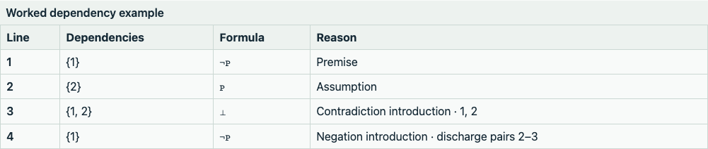

The same rule in tree form:

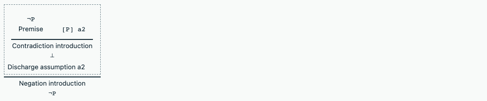

Validation: **502 web tests** passed; the production build passed. New content checks cover all 19 abstract patterns and citation counts, **57 full worked proofs** accepted by the real checkers (19 × three formats), keyboard aliases and enabled/custom-label presentation without network calls. Existing practice cases now assert the associated contradiction hint in each format; those 17 cases passed a focused rerun after adding the assertions. Focused Chrome smoke opened reference/keyboard help in all formats at desktop/mobile widths, checked local overflow at 390px/320px, and verified that inline help does not change pending work or enable checking. It reproduced the reported six-line route from `P`, through `¬P`, `P ∧ ¬P`, explicit `⊥`, `¬¬P` and back to `P`, with discharge 2–4 and explicit dependencies; the checker accepted it. No page errors were recorded. Temporary servers/schema were cleaned up. Local evidence: `.codex-local/ui-audit/029/proof-reference/`.

Formatting, whitespace and local Markdown targets passed. Backend/database suites and live account/payment services were not exercised for this frontend reference change. This is focused instructional/UI verification, not a completed accessibility or browser matrix. Continue user proof-editor QA before extending the confirmed-entry interaction to Fitch and trees.

## User QA direction: simplify the editor

**UI-029-007**, November 9, 2026: the user found the guide prose and overall editor excessive. Treat the proof and its entry area as the primary interface; prefer visual notation and concise action labels over repeated explanatory paragraphs. Keep actionable errors and necessary loss-of-work warnings. The worked-example tables remain provisional and will be reconsidered with the broader proof presentation.

The keyboard guide now contains only its notation table, including A–Z and contradiction input. Rule help contains its abstract pattern and format-specific worked example, without catalog/alias paragraphs, reference-count prose, scope tutorials or caveats. Remove unused explanatory strings from the reference data. Shorten formula hints to `Contradiction: type _|_ for ⊥.` Remove duplicate permitted-rule/format displays from active practice and shorten session/reset/dependency copy. Existing checking, permissions, pending-entry protection and explicit saving are unchanged.

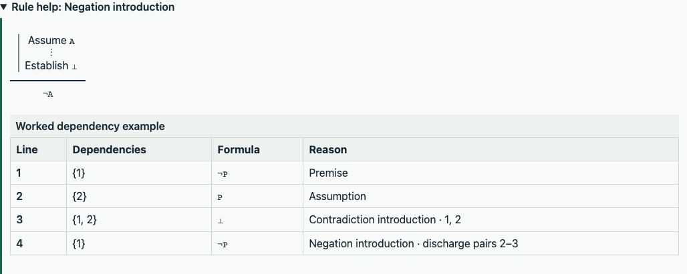

Validation: **502 web tests**, the production build, formatting, whitespace and local Markdown targets passed. Reference regressions now assert that explanatory paragraphs are absent while notation/pattern/example content remains. Focused Chrome checked all three formats and 390px/320px layouts without page errors or document-wide overflow; temporary servers/schema were cleaned up. Local evidence: `.codex-local/ui-audit/029/proof-simplification/`. Backend/database suites and the broader accessibility/browser matrix were not repeated. This reduces copy and duplication; it does not complete the larger editor interaction redesign.

## Implementation: compact dependency proof presentation

**UI-029-008**, November 9, 2026: use the [Open Logic proof constructor](https://proofs.openlogicproject.org/) as a visual reference for a compact, textbook-like proof. Replace the dependency display's visible grid, column headers and outer card with aligned dependencies, quiet line numbers, mathematical formula typography and adjacent justifications. A thin rule separates the initial premises from subsequent lines. Keep small, always-available Edit controls; underline the selected control and emphasize its line number. Preserve semantic table labels for assistive technology while hiding the visual header. Necessary horizontal scrolling stays within the proof region.

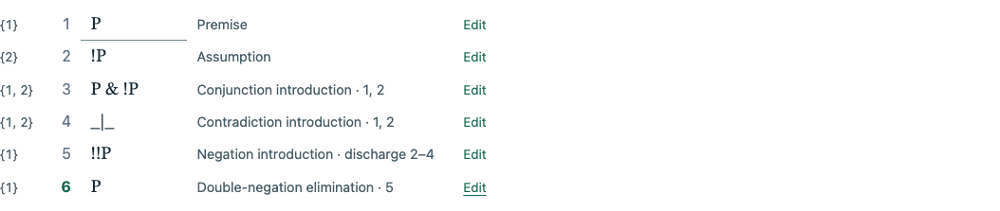

This iteration changes only dependency presentation. Input text, IDs, citations, explicit checking, pending-entry handling and saves are unchanged; Fitch/tree presentation and entry controls remain for subsequent visual review. No source/assets from the reference site were incorporated.

Validation: **502 web tests** passed, followed by a focused five-case editor rerun after final visual adjustments; the production build passed. Focused Chrome verified explicit checking, editing, moves/deletion with retained/missing references, desktop and 390px/320px local overflow, and no page errors. Temporary servers/schema were cleaned up. Final screenshots/logs: `.codex-local/ui-audit/029/dependency-math-layout/`. Formatting, whitespace and local Markdown targets passed. No new CSS-value tests, backend/database run or full assistive-technology/browser matrix. Ready for the user's next visual refinement pass.

## Implementation: inline dependency entry and line-action menus

**UI-029-009**, November 10, 2026: replace the separate dependency control panel with one input row at the bottom of the proof, aligned with dependencies, automatic line number, formula, rule/citations and confirmation. The dependencies dropdown uses checkboxes; Rule offers enabled inferences and Assumption. Starting premises are copied from the setup and no further premise insertion is offered by the dependency constructor. Existing lines retain editing/repair support. An untouched blank row stays clean and does not block checking or saving; changing it activates the existing pending-entry guards. Add line (or Enter in the formula field) confirms work without checking or saving. Discard retains the entered proof. Enter is intercepted to avoid submitting the surrounding authoring form.

Each line's **⋯** opens Edit, Move up/down, Insert before and Delete. Keep stable identities and explicit deletion confirmation; unavailable references/dependencies remain repairable. Editing existing work uses the same bottom row, followed by Done editing. Move guidance into a collapsed Input guide; remove the New line button group and standalone editing card. Keep role/release rules, explicit saves and authoritative-replacement protection unchanged. Fitch/tree input changes remain for subsequent slices; review this dependency version first.

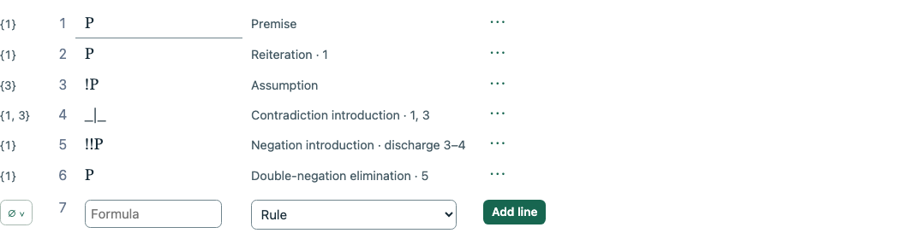

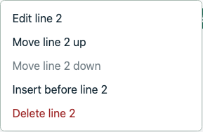

Validation: **503 web tests** and the production build passed, followed by a focused 14-case authoring/editor rerun after final focus and Enter handling. Coverage includes clean idle rows, no new-premise option, checkbox dependencies, assumption/inference switching without losing typed fields, action menus, insertion/moves/deletion, stale-base protection, pending guards and Enter without implicit saving. Native top-layer popovers avoid clipping inside the proof's horizontal scroll area. jsdom uses a visibility/toggle stub; native behavior is separate browser evidence.

Focused Chrome verified inference/assumption/discharge entry, explicit accepted checks, Add/Discard, line moves/deletion, menu initial focus/Escape/return, and 390px/320px top-layer popup positioning with local scrolling and no page errors. Temporary servers/schema were cleaned up. Evidence: `.codex-local/ui-audit/029/dependency-inline/`. Final Enter handling was tested in the authoring regression rather than a new browser run. Formatting, whitespace and local Markdown targets passed. No backend/database changes or full accessibility/browser matrix; secondary-browser native-popover coverage remains pending.

## Implementation: review the whole practice flow

**UI-029-010**, November 10, 2026: user QA identified repeated statement content, weak goal placement, crowded setup, redundant help, an unsuitable rules disclosure, an unhelpful input guide and bland check results. Address these as one flow rather than isolated spacing patches:

- Space setup into format/keyboard controls, optional premise rows, a separate conclusion field and primary/secondary actions. Remove duplicate keyboard instructions. Permitted rules now open a native modal grouped into Core, Derived and Classical rules, with bulk selection and a selected count. Choices apply immediately; Done/Escape retain them. Restore focus explicitly on close.
- Beginning independent practice initializes the proof directly, without a second Start proof action or automatic checking. Reuse the existing format-specific constructors and keep full-reset/unsaved-work behavior. Assigned-work start behavior is unchanged.
- Put a highlighted Goal beside Your proof/Reference proof in shared editor headings. Remove the duplicated premise/conclusion panel from active practice and active assigned editing. Trees retain a compact available-premises line because their starting tree does not contain premise leaves. Read-only assigned review retains its statement information.
- Replace the generic input instruction table with an annotated proof-row key showing exactly where dependencies, numbering, formula, justification and actions appear. Keep just one dependency explanation.
- Give authorized check reports green/check, rose/attention and amber/unknown treatments with explicit text and symbols. Keep diagnostics, target status and independent disclosure rules. Move feedback styling to the component's own stylesheet so it also loads in review contexts.

Setup:

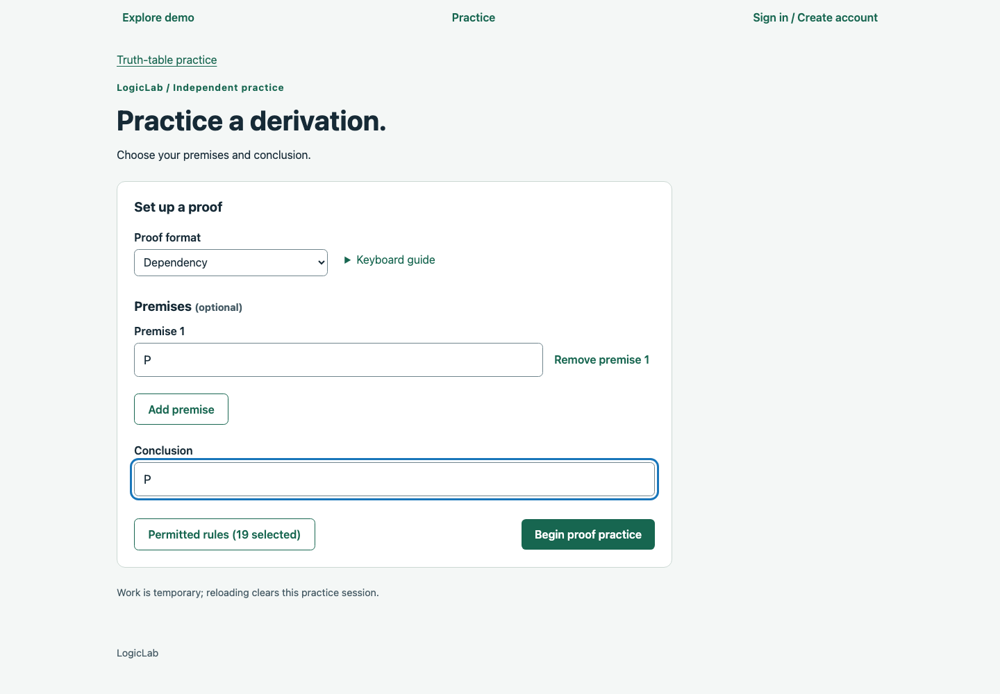

Rules on mobile:

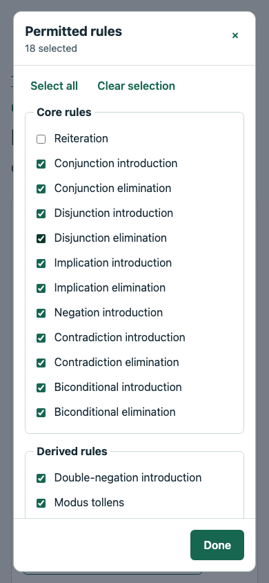

Started proof and positive feedback:

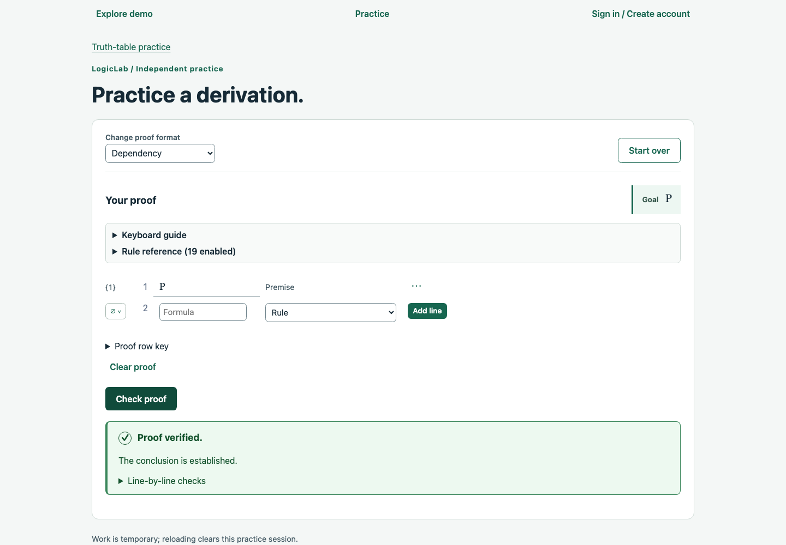

Invalid work:

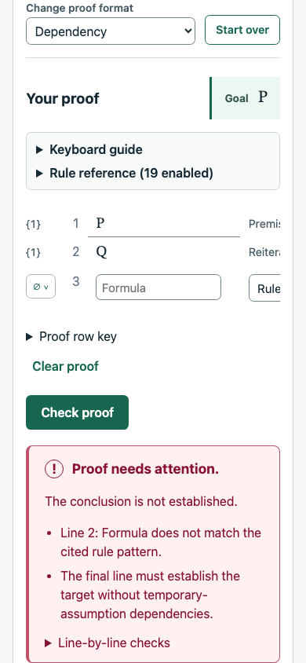

Validation: **506 web tests** and the production build passed. Updated practice regressions cover direct start without checking, the nearby goal/no duplicate premises, grouped rule selection, Escape retention, unload protection and modal focus return, alongside existing pending-entry/reset/release tests. Chrome reviewed the complete setup→modal→started proof→success/error flow, the row key, all three formats' direct starts, modal keyboard navigation/background inertness/Escape/focus return, and Stay retention. Final narrow-screen refinement keeps the format/reset toolbar compact and the dependencies trigger on one line. At 390px/320px there was no document-wide overflow; no page errors were recorded. Temporary servers/schema were cleaned up. Evidence: `.codex-local/ui-audit/029/proof-flow/` and `proof-flow-final/`.

Formatting, whitespace and local Markdown targets passed. Backend/database suites and live services were not exercised. This is a focused Chrome visual/interaction pass, not a complete assistive-technology, contrast or browser matrix. Fitch/tree line-entry redesign and further user visual refinement remain open.

## Implementation: focused rule selection and proof notation

**UI-029-011**, November 10, 2026: refine the practice/editor flow after the next user review.

- Defer mounting the permitted-rules modal until the opening gesture finishes and suppress repeated clicks from that gesture. Opening does not change a rule selection; a fresh checkbox action does. Group Core rules by operator, retaining separate Derived/Classical groups and immediate selections on Done/Escape.
- Rename the visible Goal to **Conclusion** and display logical symbols. Separate Keyboard guide and Rule reference into bordered panels, side by side on wide screens and stacked on narrow screens. One reference selector shows one permitted rule's pattern/example, using configured labels.
- Remove Proof row key. Label the dependencies popup **Dependencies**; retain the semantic table headings for assistive technology.
- Translate proof formula aliases while typing/pasting (`->`, `<->`, `!`, `~`, `&`, `v`, `|`, `_|_`) in setup, reference/student editors and instructor derivation statements. Wait for the last underscore of `_|_`, retain invalid/incomplete text, preserve the caret and defer conversion during IME composition. Existing ASCII values display symbols without silently editing stored work. This is notation conversion, not proof checking.
- Dependency introduction rules with no earlier assumption now offer **Start assumption** rather than empty Assume/End selectors. This explicitly changes the unconfirmed row to an assumption while retaining its visible formula. Add that line, construct the supporting work, then use **⋯ → Discharge assumption** on its line. The closing entry selects that assumption and defaults to implication introduction when permitted; the rule remains selectable. The student supplies the ending line, concluding formula and dependencies. Ending choices begin at the selected assumption; unresolved references remain explicit. Dependency proofs continue to use explicit dependency/discharge references rather than acquiring Fitch scope semantics.

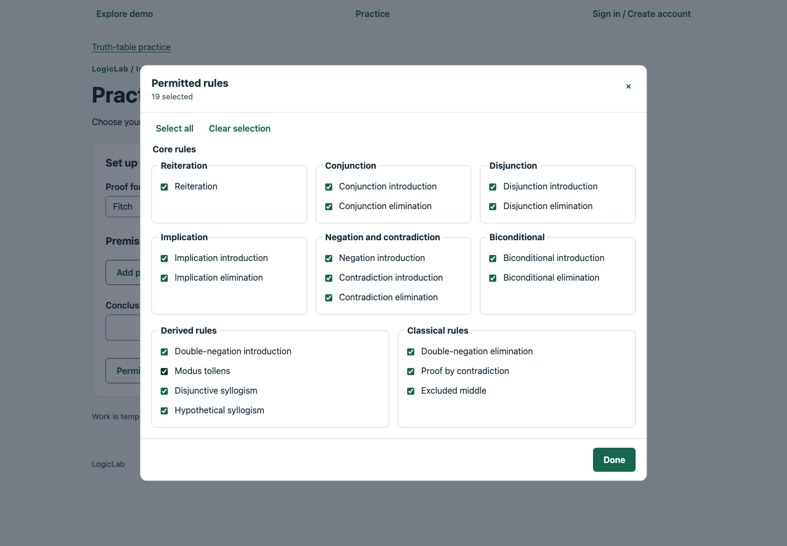

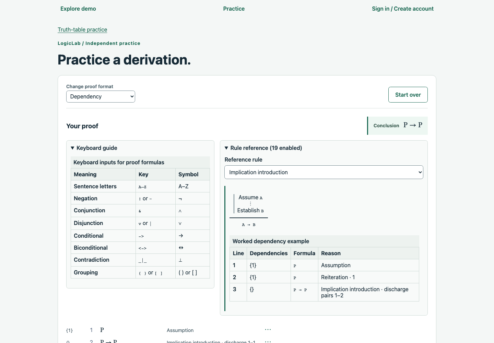

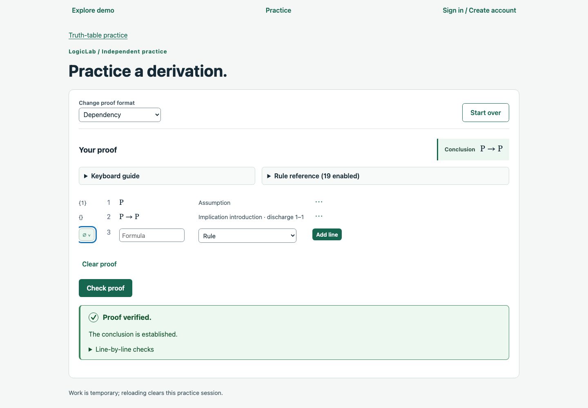

Validation: **513 web tests** and the production build passed. New coverage includes alias typing/partial tokens, existing-value preservation, caret position, IME composition, one-reference selection/permission changes, modal opening/rapid-click isolation/operator groups, and explicit assumption/discharge entry. Existing authoring, assigned saving, failed saves, pending-entry/navigation protection and release tests pass with symbol-valued edits.

Focused Chrome verified single/double modal opening without selection changes, fresh checkbox changes, Escape/focus return, the reference selector and both guides, an accepted assumption→conditional proof through the new actions, explicit checking/pending gates, live contradiction/caret behavior, all three formats' Conclusion/input notation, and 390px/320px layout/popover containment. Screenshots were inspected; no page errors were recorded. The browser harness used the real local editor/checker, temporary servers and an isolated test schema, all cleaned up. Evidence: `.codex-local/ui-audit/029/proof-polish/`.

Formatting, whitespace and local Markdown targets checked. No backend code changed or database regression suite was repeated. This is focused Chrome evidence, not a complete browser/accessibility audit; the surrounding Fitch/tree entry redesign remains open.

## Implementation: citation layout, assumption guides and target feedback

**UI-029-012**, November 10, 2026: follow-up user QA identified uneven citation widths, difficulty tracking nested assumptions and a misleading target diagnostic.

- Put the rule selector above an equal-width two-column citation row. Discharge pairs also have consistent paired fields; the second citation no longer wraps into a full-width row by itself.
- Add compact vertical assumption guides beside confirmed formulas, with additional lanes for overlapping/nested assumptions and endpoint caps at entered discharge conclusions. Open guides have no closing cap. Lane reuse keeps separate later assumptions compact. Guides use the entered assumption/dependency/discharge references, preserve reuse after discharge, and neither validate work nor impose Fitch scopes on dependency proofs. Incomplete references remain editable; unconfirmed rows remain outside the confirmed proof display.
- Reproduce the reported premise `P` → assumption `¬P` → contradiction → `¬¬P` → DNE `P` sequence. It is accepted when the requested conclusion is `P`. The user confirmed their actual target was `¬¬P`, so there was no acceptance-rule defect. Replace the generic temporary-assumption warning with a cause-specific diagnostic: a mismatching final formula names both formulas and the final line; remaining temporary support and invalid/unknown work have separate messages. Bound formula excerpts to retain schema-valid diagnostics for long input.

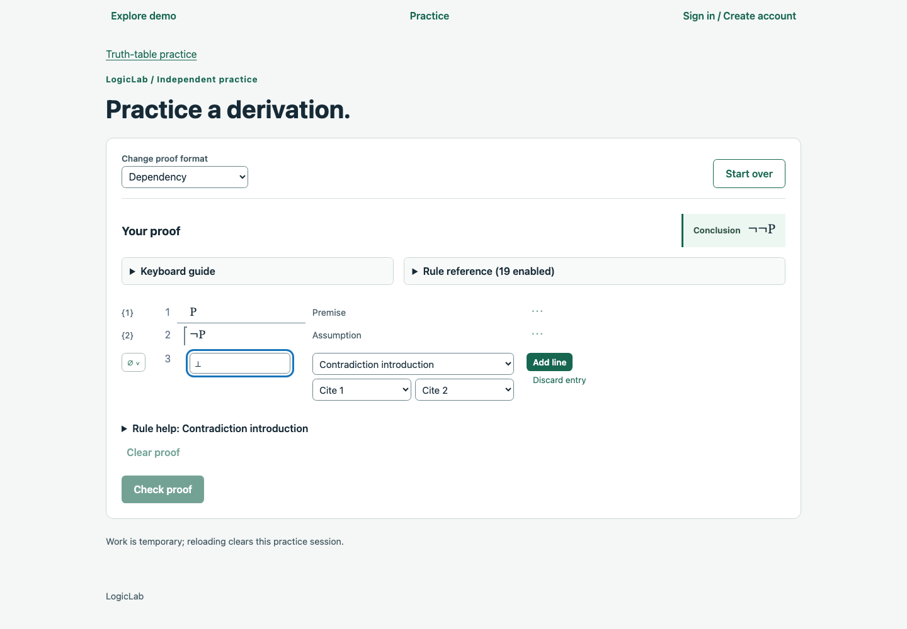

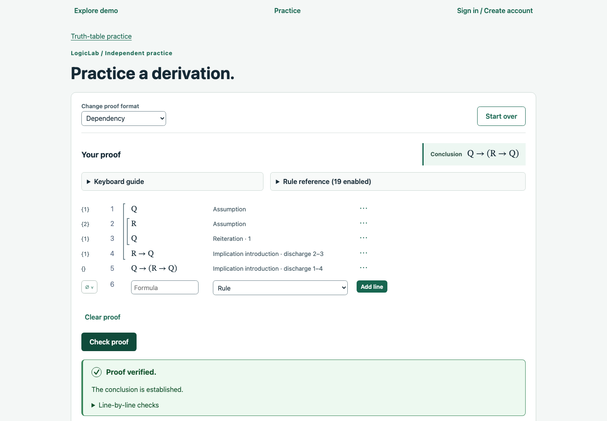

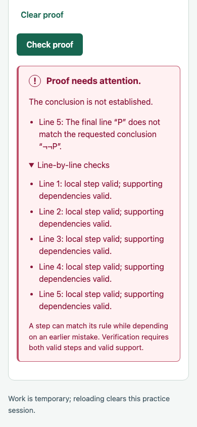

Validation: **587 engine tests**, **515 web tests**, engine/frontend builds, formatting, whitespace and local Markdown targets passed. Regression coverage includes the reported five-line derivation, mismatching targets with otherwise valid steps, remaining assumptions, bounded diagnostic text, nested guide endpoints/lane reuse, missing references, open assumptions and reuse after discharge. A focused guide rerun passed after distinguishing open from closed endpoint caps.

Chrome verified equal citation widths/vertical alignment, the reported derivation with all-valid line checks and the specific `P` versus `¬¬P` mismatch, and an accepted nested conditional proof with guide counts `1/2/2/1/0` across its confirmed lines. Desktop/mobile screenshots were inspected; 390px/320px checks found no document-wide overflow and no page errors were recorded. Temporary local servers and their isolated schema were removed. Evidence: `.codex-local/ui-audit/029/dependency-tracking/`.

No persistence/API policy changes or database regression run; this is focused local Chrome evidence rather than exhaustive visual/accessibility/browser QA.

## Implementation: line-deletion modals and dependency ordering

**UI-029-013**, November 10, 2026: individual Fitch/dependency line deletions and tree-node deletions now use a native confirmation modal. Focus begins on Keep; Escape cancels, cancellation restores focus, and confirmation removes only the selected entry while preserving unresolved incoming references. The shared prompt retains the existing whole-proof/subproof confirmation flow.

Dependency annotations now display current line numbers in ascending numeric order in the entered proof, entry control and read-only summary. Sorting is presentation-only: stored UUID order, duplicate references and missing references remain unchanged. Missing references sort after known numbers; moved lines use their current positions.

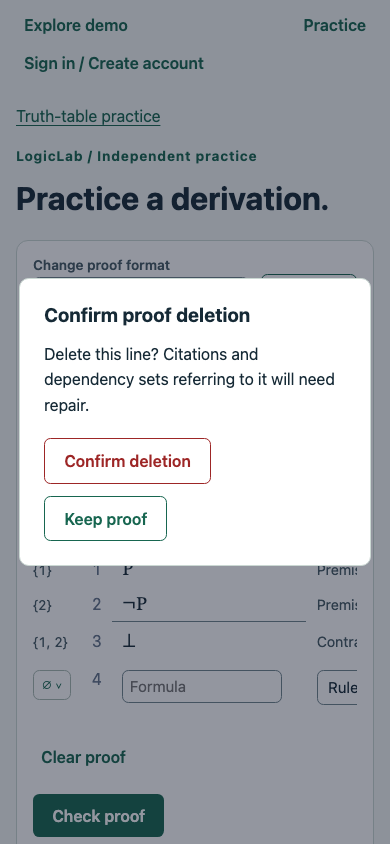

Validation: **518 web tests**, production build, formatting, whitespace and local Markdown targets passed. Added regression coverage for modal cancellation/initial focus/confirmation and numeric ordering beyond single-digit lines, current positions, missing/duplicate IDs and unchanged proof data. Existing Fitch/dependency/tree deletion tests pass with the native-dialog test stub.

Chrome verified reverse-selected dependencies displaying `{1, 2}` in a valid checked proof; modal initial focus/background inertness/Escape/focus return; mobile containment; confirmed deletion retaining missing references; and Fitch/tree cancellation. Desktop/mobile screenshots were inspected. No page errors; temporary local servers and their isolated schema were removed. Evidence: `.codex-local/ui-audit/029/proof-deletion/`. No backend code changed or database regression suite was repeated; this is focused local Chrome evidence, not a full browser/accessibility audit.

## Implementation: dependency layout across authoring and assigned work

**UI-029-014**, November 10, 2026: finish the dependency-proof layout across its real consumers. Further Fitch/tree editor redesign is deferred to separate branches, as recorded in [the audit plan](../planning/ui-ux-audit.md#required-before-deployment-proof-editor-interaction-redesign).

- Promote the grouped rules modal, gesture-safe opener and setup styles into the shared proof feature. Independent practice and dependency authoring use the same grouped picker; instructor label controls appear for enabled rules inside the modal. Disabling/re-enabling retains label drafts. Enter in a label field does not submit the surrounding authoring form. Styles load directly in authoring, without visiting practice first.
- Space dependency setup using the practice patterns. Once a reference exists, put its statement/explanation fields behind explicit **Edit statement / Done editing statement** controls. Keep the nearby Conclusion, shared guides, inline entry, assumption guides, line actions and deletion modal visible. Statement edits retain reference/premise identities; publication still requires the saved reference to pass under the current statement and rules. Instructors can deliberately edit their statement; the editor does not add new premises after start.
- Give dependency reference checking the shared colored feedback and line-by-line report, with an authoring-specific title and the explicit save-before-publication reminder. Keep local checking separate from saving and server publication checks.
- Remove the repeated permitted-rule list and redundant proof-saving paragraph from dependency attempts. Show configured starting premises before Start proof, then the same compact editor, Conclusion, guides and check action as practice. Keep assigned format/rules pinned, saving explicit, pending-entry gates and independently authorized feedback/solution access.
- Render authorized dependency previews, submitted work and solutions with the same diagram in read-only mode, without mutation controls. Submitted student review retains the authoritative problem premises/Conclusion and static rule reference. Duplicate-identity fallback remains explicit instead of disguising malformed data.

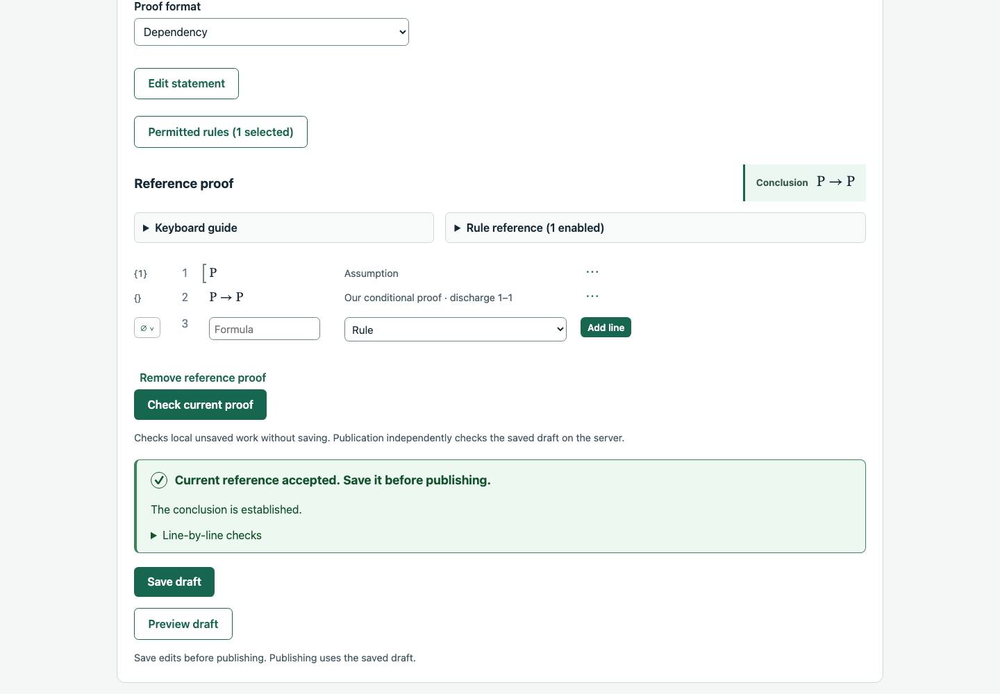

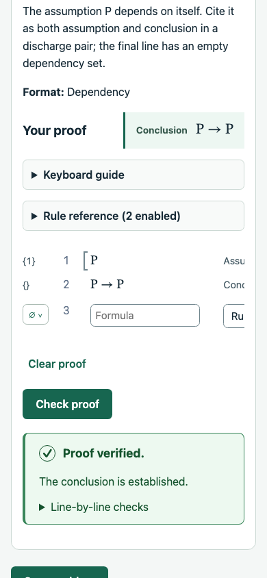

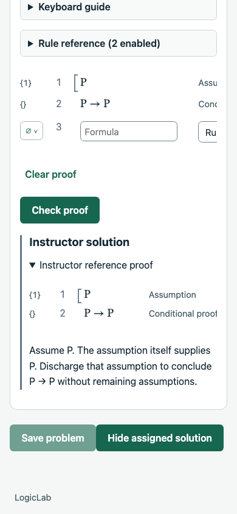

Validation: **521 web tests**, production build, formatting, whitespace and local Markdown targets passed. New coverage checks grouped authoring/labels, Enter isolation, disable/re-enable retention, deliberate statement edits with preserved references, compact student start without automatic writes/checks, and submitted read-only diagrams with authoritative premises. Existing saves/failures, pending entries, archive/busy states, grading/release and other-format regressions remain passing.

Chrome started directly in instructor authoring, edited a custom rule label, constructed/checked a dependency reference, explicitly saved/published it, and checked the compact authoring state. The student journey used a real seeded demo assignment to build/check/save/reload a dependency proof and fetch its independently authorized reference diagram. Reload retains its existing return-to-first-problem behavior; the script reselected problem 2 to inspect persisted work. Practice's shared picker was rechecked. Desktop/mobile screenshots were inspected, no page errors occurred and 390px/320px checks found no document-wide overflow. Temporary servers and their isolated schema were removed. Evidence: `.codex-local/ui-audit/029/dependency-contexts/`.

No backend/persistence policy changes or database regression suite rerun. Submitted-review controls also have component coverage; the focused browser journey covered assigned practice and authorized solutions, not a new graded-finalization/release journey. Normal and demo consumers share these components; no live Cognito/normal-account browser session or complete accessibility/browser matrix was exercised.

## Implementation: separate dependency reference-authoring step

**UI-029-015**, November 10, 2026: replace the collapsed statement/reference arrangement from UI-029-014 with two deliberate steps inside problem authoring, shared by normal/demo screens.

1. **Problem details**: title/instructions, format, premises, conclusion, permitted rules/labels and reference explanation. Incomplete drafts can still be saved without starting a reference.
2. **Reference proof**: problem title, nearby Conclusion, proof constructor, guides and checking feedback. The library list, metadata fields, previews, saved-check and publication/archive panels are out of view. Save the draft here, then return to Problem details to publish.

Entering reference construction explicitly seeds starting premises only when no reference exists. Back/forward step navigation retains the local draft and existing line identities; later statement changes do not rewrite reference steps or silently recheck them. An unconfirmed entry disables step navigation as well as save/check/preview. Step transitions focus/scroll to the workspace heading. The library retains the chosen step through successful save/remounts and resets it only on a consented new/problem selection; failed saves retain the workspace. This is page-local UI state, not a new URL, automatic save or browser-storage feature. Hidden metadata is still validated when saving from the reference step, with named field errors and a route back through Problem details.

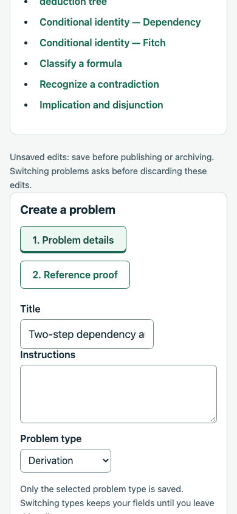

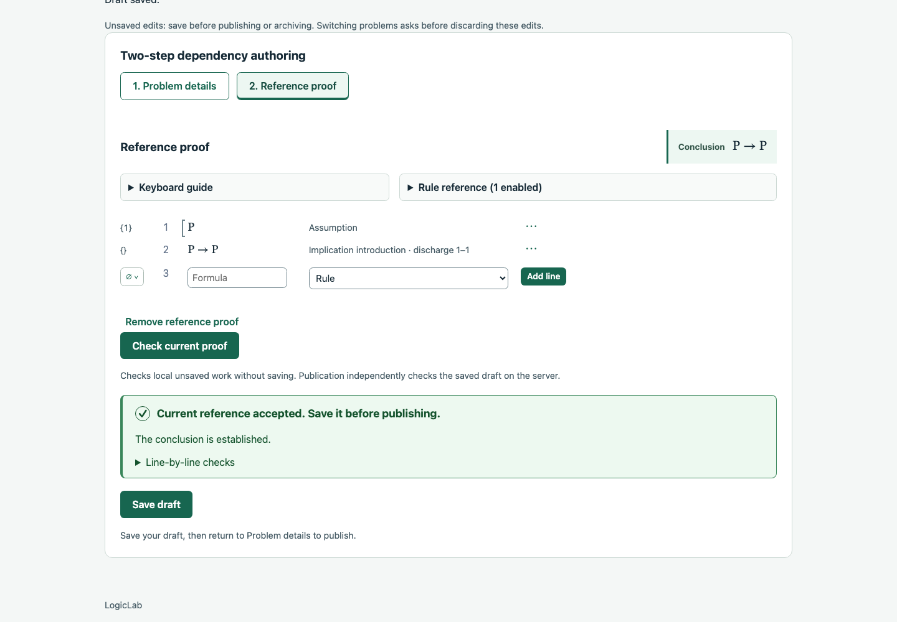

Validation: **524 web tests**, production build, formatting, whitespace and local Markdown targets passed. Coverage includes cross-step draft/reference retention, copied premise identity after statement edits, pending-entry navigation guards, validation of hidden metadata, successful-save remount retention and new-problem reset, plus existing failed-save, publication, archive/busy and other-format regressions.

Chrome verified a real local draft save without a reference, explicit reference construction, identity-preserving step navigation, changed-target checking, pending navigation guards, an injected save failure/retry, successful saves retaining each step, and publication after returning to details. Desktop/mobile screenshots were inspected; 390px/320px checks found no document-wide overflow and no page errors occurred. Temporary servers and their isolated schema were removed. Evidence: `.codex-local/ui-audit/029/dependency-authoring-steps/`. One save failure was synthetic; other workflow responses used the real local demo API. No backend changes/database regression rerun, live normal-account authentication or full browser/accessibility matrix.

## Implementation: confirmed premises and published-first library views

**UI-029-016**, November 10, 2026: address the next instructor-authoring QA findings across problem types.

- Separate successive fields, labels, option controls and explanations consistently, including conceptual correct-answer/explanation boundaries and the dependency Premises heading. Keep dependency-number sets on one line. Final Chrome measurements show 20px answer/option-to-explanation gaps in both conceptual forms.
- Replace dependency premise cards with the shared proof-style confirmed list and input row in both instructor setup and independent dependency practice. Add/Update confirms a nonblank premise; an untouched next row creates no statement source. Moves/edits retain IDs; deletion uses explicit modal consent. Pending premise entries protect unsaved work and block save/preview/step changes until added or discarded. Step entry validates the statement syntax while unfinished drafts remain saveable.
- Prevent phantom blank reference sources: the former Add action allocated blank statement rows immediately, and reference startup copied every row. Confirmed-entry setup now copies exactly the authored premises. Regression/browser checks verified one confirmed premise becomes exactly one reference source. Existing mismatched references show a source-review notice; a confirmed restart replaces the reference from the statement, explicitly warning that derived work is removed. Keep preserves the original proof. Statement edits never silently rewrite reference steps.
- Add owner-scoped publication metadata to private list items: never-published Draft, Published vN, and Published vN with Draft changes. Fetch the latest snapshot in one batch query per page; compare saved title/instructions/definition, not timestamps. Confirmed publication status survives a failed list refresh. Single-draft read/write shapes are unchanged; [the API contract](../api/problem-library-api.md#pagination-and-errors) records matching-build rollout without a migration.
- Open published selections as immutable latest-version displays with an explicit **Edit draft** action. Draft edits do not alter that view's snapshot. Publication leads to a green/check success panel and refreshed list badge. Keep uncertain publication failure/reload behavior; do not retry a publication automatically. Permitted rules in read-only views now use a modal rule selector/reference instead of a long inline list.
- Record [instructor rule-label preferences](../planning/ui-ux-audit.md#future-feature-instructor-rule-label-preferences) as a separate future feature. No preference storage/settings page is implemented in this audit.

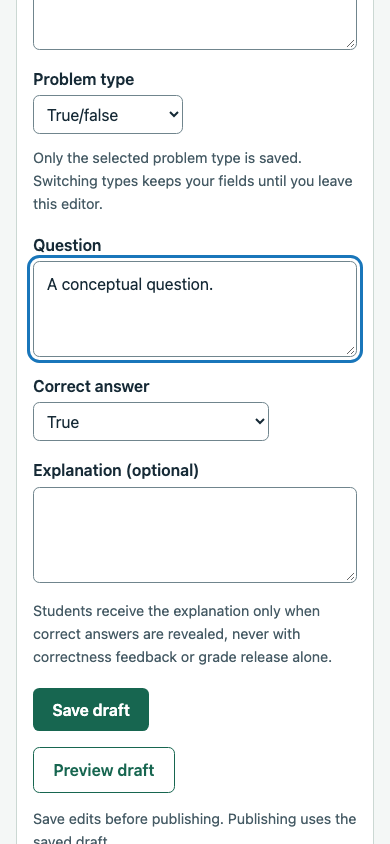

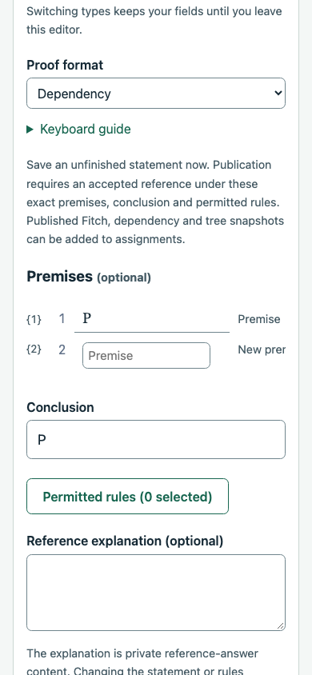

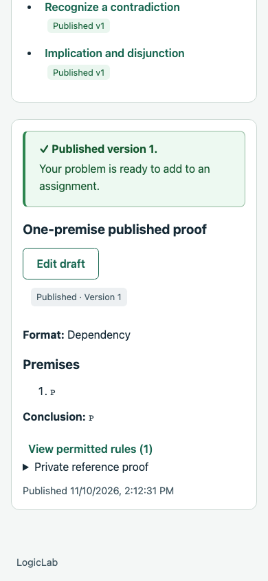

Validation: **534 web tests**, **1,051 API tests**, contracts/frontend builds and API type checking passed. Two focused PostgreSQL tests passed, covering existing library HTTP ownership/archive behavior and the new draft/publication/change/pagination/owner-isolation projection. New UI regressions cover confirmation without blank sources, IDs and pending guards, stale-reference restart consent, immutable published-first display, explicit editing, publication success, and list-refresh failure after confirmed publication. Initial broad web execution had timeouts; a bounded four-worker run passed. The API watcher initially hit the sandbox's EMFILE limit; the full suite passed outside the sandbox.

Chrome used real local demo APIs for published selection, rule viewing, premise authoring, one-source reference checking/save/publication, draft-only changes, immutable snapshot display, confirmed reference restart and version-two publication. It also verified the shared dependency practice setup. A focused final spacing pass inspected true/false, multiple-choice and dependency setup, including 390px/320px bounds. Screenshots were inspected; no page errors were recorded. Temporary servers and their isolated schemas were removed. Evidence: `.codex-local/ui-audit/029/authoring-polish/` and `authoring-polish-spacing/`.

Formatting, whitespace and local Markdown targets checked. No migration or user development-database reset; no new grading/release policies. This is focused local verification, not full product QA, live Cognito/payment testing or an accessibility/browser matrix. Rule preferences remain documented future work; further Fitch/tree editor redesign remains on separate branches.

## Route/state inventory

Each ID below has desktop/mobile captures and metadata in the ignored baseline folder. Some have an additional scrolled-content capture. All are presentation observations; source labels distinguish real local workflows from fixtures. The two CSS row comparisons are additional element captures, not separate route states.

| ID   | Route               | Captured state                                       | Data source                                                      |
| ---- | ------------------- | ---------------------------------------------------- | ---------------------------------------------------------------- |
| AC00 | `/account`          | Account page when this test server has auth disabled | real disabled-auth server                                        |
| AC01 | `/account`          | Logged-out sign-in form                              | 401 session fixture; no live Cognito                             |
| AC02 | `/account`          | Sign-up form                                         | logged-out session fixture                                       |
| AC03 | `/account`          | Email confirmation form                              | logged-out session fixture                                       |
| AC04 | `/account`          | Account recovery form                                | logged-out session fixture                                       |
| AC05 | `/account`          | Reset-password form                                  | synthetic reset response; no email sent                          |
| AN01 | `/`                 | Empty truth-table practice                           | real demo/public API                                             |
| AN02 | `/`                 | Debounced formula error                              | real demo/public API                                             |
| AN03 | `/`                 | Truth table: unanswered feedback and shown solution  | real public API                                                  |
| AN04 | `/practice/proofs`  | Self-created proof setup                             | real demo/public API                                             |
| AN05 | `/practice/proofs`  | fitch editor on a fresh page                         | real local editor                                                |
| AN06 | `/practice/proofs`  | dependency editor on a fresh page                    | real local editor                                                |
| AN07 | `/practice/proofs`  | tree editor on a fresh page                          | real local editor                                                |
| AN08 | `/practice/proofs`  | Full-reset confirmation                              | real local editor                                                |
| AN09 | `/not-a-real-page`  | Not-found page                                       | real demo/public API                                             |
| AN10 | `/practice/proofs`  | Same Fitch editor after visiting library via SPA     | real editor after lazy library CSS loaded                        |
| DE01 | `/demo`             | Demo entry                                           | real demo/public API                                             |
| ER01 | `/demo/classes`     | Class-loading error and retry                        | injected 503 response for presentation only                      |
| IN01 | `/demo/classes`     | Instructor classes and workspace navigation          | real demo/public API                                             |
| IN02 | `/demo/library`     | Library list and empty truth-table draft             | real demo API                                                    |
| IN03 | `/demo/library`     | Library true_false authoring/history                 | real demo API                                                    |
| IN04 | `/demo/library`     | Library multiple_choice authoring/history            | real demo API                                                    |
| IN05 | `/demo/library`     | Library fitch authoring/history                      | real demo API                                                    |
| IN06 | `/demo/library`     | Library dependency authoring/history                 | real demo API                                                    |
| IN07 | `/demo/library`     | Library tree authoring/history                       | real demo API                                                    |
| IN08 | `/demo/assignments` | Assignments before class selection                   | real demo/public API                                             |
| IN09 | `/demo/assignments` | Assignment list and new draft                        | real demo API                                                    |
| IN10 | `/demo/assignments` | Published assignment controls and release policy     | real demo API                                                    |
| IN11 | `/demo/billing`     | Paid class billing                                   | real demo simulator API                                          |
| IN12 | `/demo/billing`     | Unpaid class checkout                                | real demo simulator API                                          |
| IN13 | `/demo/billing`     | Pending simulated checkout and purchase actions      | real demo simulator API                                          |
| IN14 | `/demo/assignments` | Instructor pending grading and retained evidence     | real demo API; final fixture submitted via API                   |
| LD01 | `/demo/classes`     | Classes loading state                                | real API request held by audit fixture                           |
| NO01 | `/classes`          | Normal instructor shell/classes                      | synthetic auth session; normal GETs mapped to isolated demo data |
| NO02 | `/account`          | Signed-in account panel                              | synthetic auth session                                           |
| NO03 | `/enrollments`      | Normal student shell/enrollment                      | synthetic auth session; normal GETs mapped to isolated demo data |
| NO04 | `/work`             | Normal student work shell                            | synthetic auth session; normal GETs mapped to isolated demo data |
| ST01 | `/demo/enrollments` | Student enrolled classes                             | real demo/public API                                             |
| ST02 | `/demo/work`        | Student work before class selection                  | real demo/public API                                             |
| ST03 | `/demo/work`        | Published assignment selection                       | real demo/public API                                             |
| ST04 | `/demo/work`        | Assigned truth table and save/check actions          | real demo API                                                    |
| ST05 | `/demo/work`        | Assigned conceptual question                         | real demo API                                                    |
| ST06 | `/demo/work`        | Assigned Fitch proof controls                        | real demo API                                                    |
| ST07 | `/demo/work`        | Assigned dependency proof controls                   | real demo API                                                    |
| ST08 | `/demo/work`        | Assigned tree proof controls                         | real demo API                                                    |
| ST09 | `/demo/work`        | Submitted work awaiting grade release                | real demo API; final fixture submitted via API                   |
| ST10 | `/demo/work`        | Released points/comments and read-only student work  | real demo API; grade fixture configured via API                  |
| ST11 | `/demo/work`        | Score-free completion with verification flags        | real demo API; final fixture submitted through API               |
| ST12 | `/demo/work`        | Read-only erroneous tree review                      | real demo API; final fixture submitted through API               |

## Baseline validation

Source/CSS inspection, the recorded Chrome captures, computed-style comparison and explicit cleanup were performed. Documentation formatting, whitespace and local links are checked before handoff. No application or test code changed, so functional suites were not repeated. Full validation and the local PR draft belong at branch closeout; [the audit plan](../planning/ui-ux-audit.md) remains the scope/completion guide.
