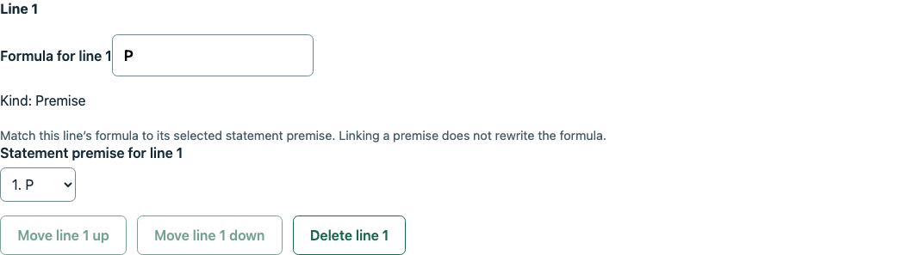
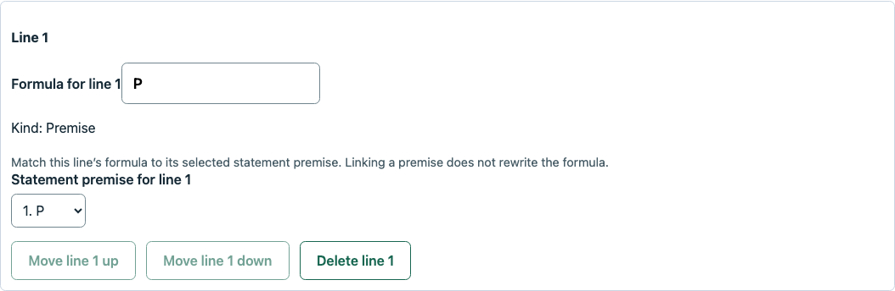
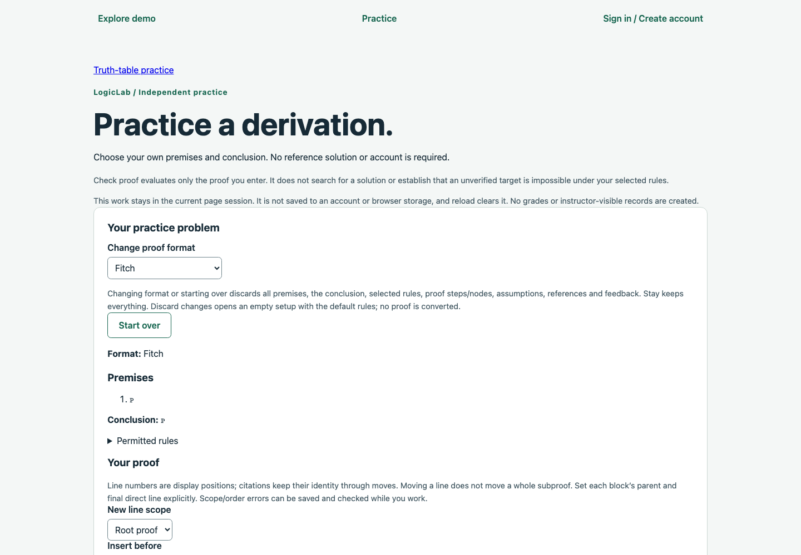
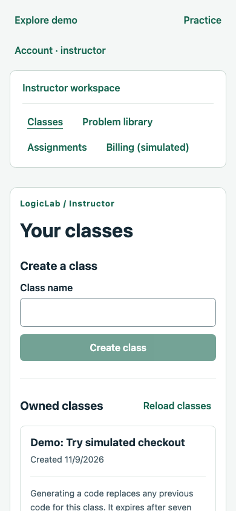
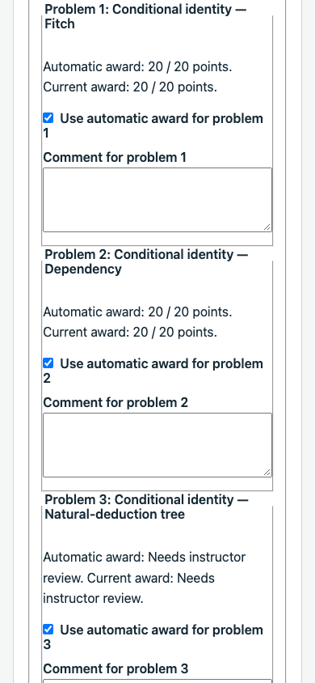
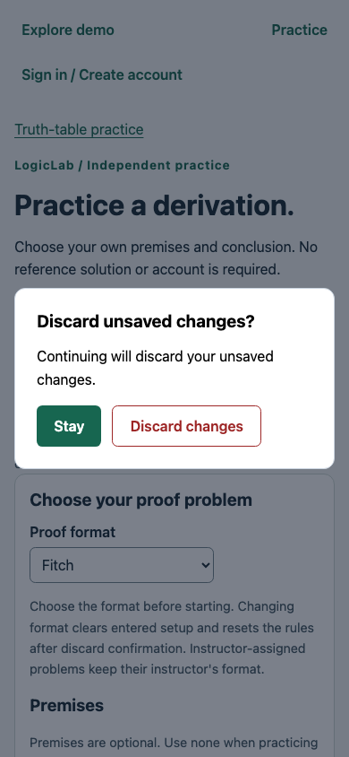

# UI/UX audit: baseline and proposed work

Run: **UI-029-001**, November 9, 2026. Branch: `029-chore-ui-ux-audit`. Baseline checkout: `97a0db3`. The baseline slice inventoried presentation without changing application code. Subsequent implementation and verification are recorded below; findings remain open unless explicitly resolved.

## Agreed direction and working targets

The user accepted a calm, clean academic direction: readable typography, restrained color, clear workspace navigation and meaningful action hierarchy. Keep the existing teal/slate/neutral palette as a starting point, system fonts, and textual correctness/verification signals. Avoid a wholesale component-library migration. Desktop is primary; mobile must remain usable.

Chrome is the initial baseline. The user's everyday browser was not specified. Safari is available locally but was not exercised; schedule a secondary-browser spot check when feasible. These working accessibility targets guide implementation and verification, not a conformance claim:

- Complete core tasks by keyboard, with visible focus and predictable focus after dialogs, added proof lines and navigation.
- Provide meaningful control labels, grouped choices, associated help/errors and understandable loading/status announcements.
- Keep correctness, pending review and destructive actions understandable without relying on color.
- Check text/control/focus contrast, reduced motion, 200% zoom and narrow layouts during the implementation passes.
- Use 1440×1000 desktop and 390×844 mobile baselines, then include a shorter desktop viewport and 320px/zoom stress checks before closeout. Necessary proof/table scrolling should stay within its content area.

## Baseline evidence and boundaries

Captured **49 route/state combinations** at both baseline widths, plus selected scrolled content and proof-row comparisons: **125 screenshots** retained locally under `.codex-local/ui-audit/029/baseline/`, with `inventory.json`, scripts and logs. Representative images below are tracked and were visually inspected alongside the source review. Headless Chrome was **156.0.8078.81**. No document-wide horizontal overflow was observed at 390px in those captured states; this does not establish large-proof, long-content or full responsive coverage.

Demo/public views used real local APIs and an isolated disposable PostgreSQL schema. Saved/final/released examples were prepared through public APIs to expose review states. Normal-account shell views used a synthetic auth-session response and read-only normal GETs mapped to that isolated demo graph. Login/recovery presentation included labeled session/reset/error fixtures; no live Cognito/email flow was exercised. A held class request and an injected 503 expose loading/error views. These fixtures are presentation evidence, not normal authentication, authorization or email verification.

Initial capture attempts needed script corrections for the normal-account interception boundary and a student heading. Valid initial captures were retained; the supplemental run completed the remaining views. Final records report no uncaught page errors. Temporary servers and schemas were removed after each attempt. No user development database or external service was changed. This is not an end-to-end QA sign-off.

## Prioritized findings

| ID       | Priority                                  | Finding                                                                                         | Evidence                                                                                     | Proposed response                                                                                        |
| -------- | ----------------------------------------- | ----------------------------------------------------------------------------------------------- | -------------------------------------------------------------------------------------------- | -------------------------------------------------------------------------------------------------------- |
| UI029-01 | High                                      | Proof-row styling depends on navigation history.                                                | AN05, AN10; CSS01/CSS02 comparison below.                                                    | Move shared card styles to their actual shared owner; verify direct and SPA visits match.                |
| UI029-02 | High, required before deployment          | Proof entry exposes the editable storage structure before a clean growing proof.                | AN05–AN07, ST06–ST08; existing agreed redesign.                                              | Prototype dependency proof display plus next-line entry first, then Fitch and tree interactions.         |
| UI029-03 | Medium                                    | Reference authoring and review require excessive vertical scanning.                             | IN05–IN07, IN14.                                                                             | Separate primary editing/review tasks from rule configuration, history and advanced controls.            |
| UI029-04 | Medium                                    | Workspace identity competes with site links, and the mobile header consumes substantial height. | IN01, NO01, NO03; earlier user finding.                                                      | Strengthen role/workspace treatment while retaining distinct site/workspace navigation.                  |
| UI029-05 | Medium                                    | Form controls and ordinary links lack one consistent visual treatment.                          | IN05, IN14, AN05; shared/global CSS inspection.                                              | Establish shared field/link/textarea styles and spacing with explicit checkbox/radio exceptions.         |
| UI029-06 | Medium                                    | Several editing, primary workflow and destructive actions have similar emphasis.                | AN05–AN07, DE01, IN14; proof deletion controls.                                              | Define primary/secondary/quiet/destructive variants and apply them by task.                              |
| UI029-07 | Medium                                    | Long instructional text precedes the working area and repeats across layers.                    | AN05, ST07, IN05–IN07.                                                                       | Keep essential task/release guidance visible; move detailed mechanics into contextual help/disclosures.  |
| UI029-08 | Small navigation fix                      | Proof practice has no current-page cue on the global Practice link.                             | AN05; root Practice link uses exact matching.                                                | Make the Practice section identifiable across table/proof routes without duplicating the top-level link. |
| UI029-09 | Verification gate, not a diagnosed defect | Keyboard, contrast, zoom, assistive-technology and secondary-browser coverage is incomplete.    | This slice is observational; source review confirms some existing accessibility foundations. | Run the agreed checks as each shared/domain interaction changes and record outcomes/limits.              |

### UI029-01: confirmed route-dependent styles

The proof editors use `.problem-option`, whose border/padding/margin are defined only in [problem-library.css](../../apps/web/src/pages/problem-library/problem-library.css). That stylesheet belongs to the lazy-loaded owner-library page. On a fresh direct visit to proof practice, a premise row has `0px` border, padding and margin. Visit the library, then return through SPA links and build the same proof: it has `1px` border, `12px` padding and `12px` margin. Computed styles and element screenshots confirm the difference; the proof data and viewport are equivalent.

Direct visit:

After loading the library stylesheet through navigation:

The first implementation slice should correct ownership of genuinely shared presentation before layering new visual rules on top. Inspect `.correct-option` and other reused selectors for similar ownership issues; do not simply import an unrelated page stylesheet into every proof component.

### UI029-02/03/07: make the proof the focal point

Independent practice currently places setup/reset explanations, statement details and editor instructions before line controls. The dependency authoring example IN06 had 81 form/action controls in the DOM and a 9,486px document at 390px width; disabled/collapsed controls are included in that count. IN14's pending grading/review page was 7,854px tall. These are observations of seeded examples, not permanent thresholds or test assertions.

Use a compact proof display that grows as entries are confirmed, with a focused entry/edit area. Keep stable identities, unresolved references, incomplete drafts, explicit checking/saving and independent release rules. Add line is an editing action, not a correctness check. For trees, use deliberate branch/node construction instead of a numbered-line form. Cover instructor references, assigned student work and self-created practice together.

One decision to settle with the first prototype: how pending entry fields interact with Check, Save and final submission. A practical candidate is to require explicit entry confirmation or discard before those actions, while retaining pending text and marking it unsaved. Confirming must still allow the incomplete/incorrect draft states supported by the existing workflow; it must not add hidden grading diagnostics. This candidate is not an implemented policy decision.

### UI029-04/05/06: shared foundations

On IN01 at 390px, the main content begins approximately 382px down a viewport of 844px. The existing two-level navigation is meaningful, but the role title and workspace links need stronger grouping with less vertical overhead. Keep normal/demo boundaries and the visible synthetic-data notice.

Normal instructor shell, using the explicitly synthetic auth/data fixture:

[global.css](../../apps/web/src/styles/global.css) gives inputs/selects/buttons a shared font and radius, while textareas receive partial per-page rules. The grading view exposes browser-default textarea/fieldset borders beside styled inputs. Ordinary content links can remain browser blue while navigation links are teal. Normalize these differences deliberately, without applying text-input widths to radios/checkboxes or flattening meaningful choice groups.

Keep one clear primary action per working region; make supporting controls quieter and destructive confirmation distinguishable. Existing secondary buttons, visible focus outlines, labels, policy-help associations, semantic reports and reduced-motion-aware scrolling are useful foundations to retain.

## Representative visual direction

Start with the instructor Classes screen as the shared-shell reference, then check the same treatment against student work and proof practice:

- A compact site header, followed by a clearly labeled instructor/student workspace band and obvious active destination.
- A concise page title and task summary, then separated list/editor regions. Use wider space for proof/table work and narrower readable text/form measures where appropriate.
- Existing deep teal for primary actions, slate text, quiet neutral surfaces and consistent borders/radii. Keep green/rose correctness states accompanied by words/symbols.
- A small spacing/type scale shared by labels, help, fields, panels and action rows. Textareas should look related to inputs; ordinary links should follow one recognizable treatment.
- Progressive disclosure for extended rule/reference instructions, history and less common controls. Preserve required release/privacy information at the action where it matters.

This is a proposed application of the agreed direction, not a new stylesheet or final mockup. Capture an implemented representative screen for review before propagating it broadly.

## Proposed implementation order

1. Fix shared-style ownership and introduce the field/link/action foundations; validate direct entry versus SPA navigation.
2. Apply the compact site/workspace shell to Classes as the representative screen, then verify instructor/student/demo and mobile variants.
3. Prototype the dependency proof display/entry workflow and settle pending-entry semantics; extend to Fitch and tree editing, references and retained review in focused slices.
4. Refine library/rule authoring, assignment selection/settings, student results, instructor grading, billing and account/error states using the shared patterns.
5. Run focused keyboard/focus, contrast, zoom/reduced-motion, short-screen/mobile and secondary-browser checks; close or explicitly defer findings and capture before/after evidence.

Remaining baseline gaps include archive/restore views, zero-enrollment/empty-library variants, denied/expired sessions, save-conflict/uncertain-write states, larger proofs/formulas, full keyboard traversal, zoom/reduced motion and Safari. Include them in subsequent focused work rather than implying that the captured matrix is exhaustive.

## Implementation: shared foundations

**UI-029-002**, November 9, 2026:

- **UI029-01 resolved:** move `.problem-option` from the lazy library stylesheet into the always-loaded shared stylesheet. Fitch, dependency and tree editors now receive the same border, padding and margin on direct entry and after SPA navigation through the library. `.correct-option` remains library-owned because its consumers are library fields.
- **UI029-05 partially addressed:** give textareas shared font/radius/border/padding, readable text/background and vertical resizing; unify ordinary content-link colors. Exclude radios/checkboxes from text-input sizing and padding, preserving compact native controls. Page-specific fieldset/layout refinement remains open.
- **UI029-06 partially addressed:** add an outlined destructive button variant for proof-deletion confirmations, unsaved-work discard and demo reset. Make End demo secondary. Labels, safe-action autofocus, cancellation and workflow behavior are unchanged. Broader editing/primary action hierarchy remains open for subsequent screen slices.

The next slice is the representative Classes/workspace shell. Proof entry redesign and the broader audit remain pending. No backend, assessment policy, persistence or transport changes are included.

After the shared-style fix, direct entry matches the previously styled library-navigation case:

Destructive emphasis keeps the labeled safe action and native dialog behavior:

Validation: all **402 web tests** passed; the web production build (including TypeScript checking) passed. Focused real-API Chrome checks captured ten desktop/mobile states, comparing direct and library-warmed proof cards in all three formats, exercising deletion cancellation, checking native choice-control sizing and shared textarea styling, and verifying dialog Tab/Escape/Stay/Discard behavior. The final successful run had no uncaught page errors or document-wide overflow at 390px. Temporary servers and the isolated test schema were cleaned up. Scripts, screenshots and computed-style evidence are retained under `.codex-local/ui-audit/029/shared-foundations/`.

Changed-file formatting, whitespace and local Markdown targets passed. Backend/database suites were not repeated for this presentation-only change. These focused checks do not establish full keyboard/focus containment, contrast, assistive-technology, zoom or secondary-browser coverage.

## Route/state inventory

Each ID below has desktop/mobile captures and metadata in the ignored baseline folder. Some have an additional scrolled-content capture. All are presentation observations; source labels distinguish real local workflows from fixtures. The two CSS row comparisons are additional element captures, not separate route states.

| ID   | Route               | Captured state                                       | Data source                                                      |
| ---- | ------------------- | ---------------------------------------------------- | ---------------------------------------------------------------- |
| AC00 | `/account`          | Account page when this test server has auth disabled | real disabled-auth server                                        |
| AC01 | `/account`          | Logged-out sign-in form                              | 401 session fixture; no live Cognito                             |
| AC02 | `/account`          | Sign-up form                                         | logged-out session fixture                                       |
| AC03 | `/account`          | Email confirmation form                              | logged-out session fixture                                       |
| AC04 | `/account`          | Account recovery form                                | logged-out session fixture                                       |
| AC05 | `/account`          | Reset-password form                                  | synthetic reset response; no email sent                          |
| AN01 | `/`                 | Empty truth-table practice                           | real demo/public API                                             |
| AN02 | `/`                 | Debounced formula error                              | real demo/public API                                             |
| AN03 | `/`                 | Truth table: unanswered feedback and shown solution  | real public API                                                  |
| AN04 | `/practice/proofs`  | Self-created proof setup                             | real demo/public API                                             |
| AN05 | `/practice/proofs`  | fitch editor on a fresh page                         | real local editor                                                |
| AN06 | `/practice/proofs`  | dependency editor on a fresh page                    | real local editor                                                |
| AN07 | `/practice/proofs`  | tree editor on a fresh page                          | real local editor                                                |
| AN08 | `/practice/proofs`  | Full-reset confirmation                              | real local editor                                                |
| AN09 | `/not-a-real-page`  | Not-found page                                       | real demo/public API                                             |
| AN10 | `/practice/proofs`  | Same Fitch editor after visiting library via SPA     | real editor after lazy library CSS loaded                        |
| DE01 | `/demo`             | Demo entry                                           | real demo/public API                                             |
| ER01 | `/demo/classes`     | Class-loading error and retry                        | injected 503 response for presentation only                      |
| IN01 | `/demo/classes`     | Instructor classes and workspace navigation          | real demo/public API                                             |
| IN02 | `/demo/library`     | Library list and empty truth-table draft             | real demo API                                                    |
| IN03 | `/demo/library`     | Library true_false authoring/history                 | real demo API                                                    |
| IN04 | `/demo/library`     | Library multiple_choice authoring/history            | real demo API                                                    |
| IN05 | `/demo/library`     | Library fitch authoring/history                      | real demo API                                                    |
| IN06 | `/demo/library`     | Library dependency authoring/history                 | real demo API                                                    |
| IN07 | `/demo/library`     | Library tree authoring/history                       | real demo API                                                    |
| IN08 | `/demo/assignments` | Assignments before class selection                   | real demo/public API                                             |
| IN09 | `/demo/assignments` | Assignment list and new draft                        | real demo API                                                    |
| IN10 | `/demo/assignments` | Published assignment controls and release policy     | real demo API                                                    |
| IN11 | `/demo/billing`     | Paid class billing                                   | real demo simulator API                                          |
| IN12 | `/demo/billing`     | Unpaid class checkout                                | real demo simulator API                                          |
| IN13 | `/demo/billing`     | Pending simulated checkout and purchase actions      | real demo simulator API                                          |
| IN14 | `/demo/assignments` | Instructor pending grading and retained evidence     | real demo API; final fixture submitted via API                   |
| LD01 | `/demo/classes`     | Classes loading state                                | real API request held by audit fixture                           |
| NO01 | `/classes`          | Normal instructor shell/classes                      | synthetic auth session; normal GETs mapped to isolated demo data |
| NO02 | `/account`          | Signed-in account panel                              | synthetic auth session                                           |
| NO03 | `/enrollments`      | Normal student shell/enrollment                      | synthetic auth session; normal GETs mapped to isolated demo data |
| NO04 | `/work`             | Normal student work shell                            | synthetic auth session; normal GETs mapped to isolated demo data |
| ST01 | `/demo/enrollments` | Student enrolled classes                             | real demo/public API                                             |
| ST02 | `/demo/work`        | Student work before class selection                  | real demo/public API                                             |
| ST03 | `/demo/work`        | Published assignment selection                       | real demo/public API                                             |
| ST04 | `/demo/work`        | Assigned truth table and save/check actions          | real demo API                                                    |
| ST05 | `/demo/work`        | Assigned conceptual question                         | real demo API                                                    |
| ST06 | `/demo/work`        | Assigned Fitch proof controls                        | real demo API                                                    |
| ST07 | `/demo/work`        | Assigned dependency proof controls                   | real demo API                                                    |
| ST08 | `/demo/work`        | Assigned tree proof controls                         | real demo API                                                    |
| ST09 | `/demo/work`        | Submitted work awaiting grade release                | real demo API; final fixture submitted via API                   |
| ST10 | `/demo/work`        | Released points/comments and read-only student work  | real demo API; grade fixture configured via API                  |
| ST11 | `/demo/work`        | Score-free completion with verification flags        | real demo API; final fixture submitted through API               |
| ST12 | `/demo/work`        | Read-only erroneous tree review                      | real demo API; final fixture submitted through API               |

## Baseline validation

Source/CSS inspection, the recorded Chrome captures, computed-style comparison and explicit cleanup were performed. Documentation formatting, whitespace and local links are checked before handoff. No application or test code changed, so functional suites were not repeated. Full validation and the local PR draft belong at branch closeout; [the audit plan](../planning/ui-ux-audit.md) remains the scope/completion guide.
