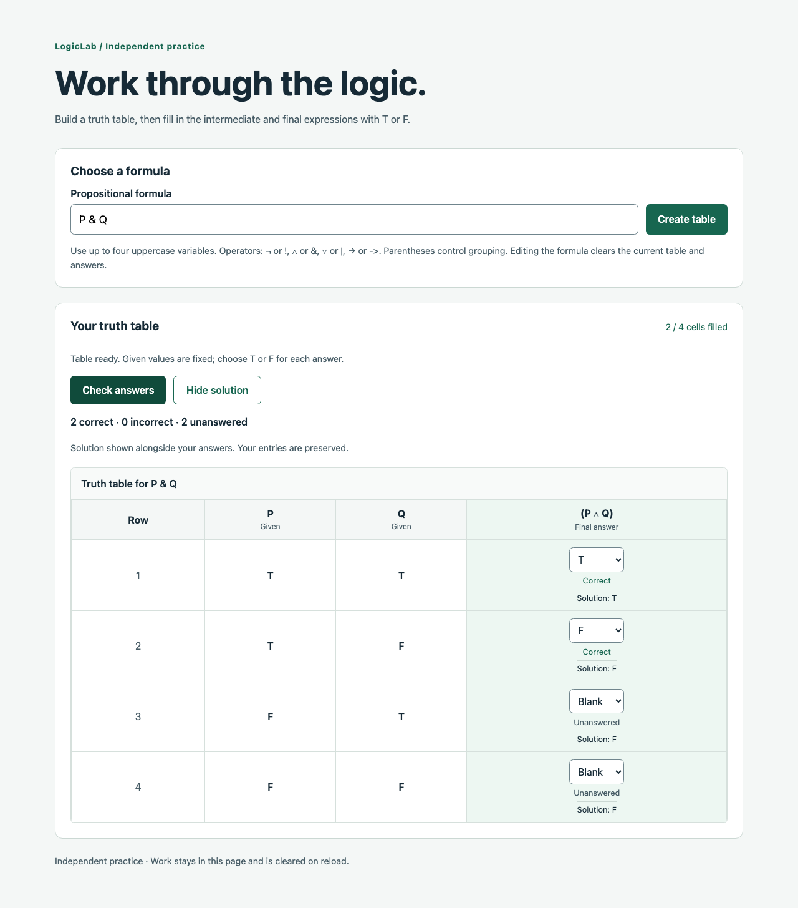

# Truth-table milestone — verification and walkthrough

Branch: `002-feat-truth-table-practice` · Verified October 12, 2026

## Implemented experience

A visitor enters a propositional formula, creates a table, fills blank/T/F answer cells, checks their answers, and reveals or hides a solution alongside their entries. Given variable values cannot be edited. Intermediate expressions appear before the final expression. Work is anonymous and stays in page memory.

The parser supports single uppercase variables, parentheses, `¬ ∧ ∨ →`, and aliases `! & | ->`. Limits are four distinct variables, 256 characters, and 32 recursive nesting levels. Rows use alphabetical variables and run from all T to all F. See the [engine documentation](../tools/logic-engine/README.md) and [API contract](truth-table-api.md).

## Reproduce the walkthrough

Use Node.js 24.9+ and run `npm ci`, then `npm run dev`. Open http://localhost:5173 after all services finish starting.

1. Enter `P & Q` and select **Create table**. Confirm four rows, fixed P/Q values, and a blank answer column.
2. Choose F in the first two answer cells and leave the others blank. Select **Check answers**: expect one correct, one incorrect, and two unanswered.
3. Select **Show solution**: expect T, F, F, F alongside the original entries. Select **Hide solution** to remove these values without changing answers.
4. Change an answer: previous check labels and summary clear. Check again to refresh feedback.
5. Enter `P &`: the existing table clears. Creating it reports an error at character 4.
6. Enter `(A & B) -> (C | D)`: expect 16 rows and three answer columns, with 48 blank selectors.
7. Reload the page: prior work is cleared. Use keyboard navigation to reach and operate the selectors; narrow screens scroll the table within its container.

## Verification performed

- `npm run check` passed: all workspace type checks, 71 engine tests, 36 API tests, and production builds.
- A clean temporary copy without `node_modules` or `dist` passed `npm ci --offline` using the existing package cache, followed by `npm run check`. This verifies lockfile installation and shared-package build order; it does not verify uncached registry access.
- A one-off Playwright smoke script drove installed Chrome through the real Vite proxy and API. Verified blank/T/F input, keyboard selection, correct/incorrect/unanswered feedback, all-correct checking, solution preservation/show/hide, formula reset, syntax errors, action failure/retry, and network failure.
- A delayed check response was canceled by editing an answer; stale feedback did not reappear or replace the new value.
- The four-variable case produced 16 rows and 48 answer selectors. At a 390-pixel viewport the page fit the screen, and browser execution reported no uncaught exceptions.
- Desktop and mobile screenshots were captured from the implemented UI. `git diff --check` and ignore-rule verification cover the documentation/workflow changes.

## Screenshots

[Mobile screenshot](images/truth-table-practice-mobile.png)

## Limits and follow-up work

- Browser smoke verification was a local one-off run, not a committed frontend test suite or a CI browser job. Only Chrome was exercised; screen-reader behavior and other browsers were not audited.
- Vite warns about a roughly 717 kB minified JavaScript chunk (168 kB gzip). Bundle optimization remains follow-up work.
- API Jest tests use experimental VM modules and emit the corresponding Node warning.
- No authentication, persistence, saved problem library, instructor assignments, official grades, or assignment solution-access policy is implemented. The solution route is deliberately public for independent practice.
- Docker PostgreSQL/DBeaver setup, authentication selection, migrations, and scoped classroom permissions belong to subsequent work. AWS deployment remains planned, not provisioned.

This milestone meets the independent truth-table vertical-slice criteria. It does not meet the complete portfolio release criteria in the implementation plan.
