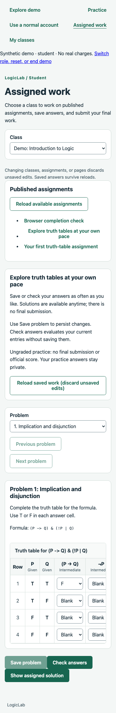

# Assignment learning modes verification

Date: October 22, 2026. Branch: `010-feat-assignment-learning-modes`.

## Final automated pass

- `npm run check`: type checks, 629 tests (71 engine, 481 API, 77 frontend), and production builds passed.
- `npm run db:test`: 152 PostgreSQL checks passed (116 database, 36 API/workflow).
- Formatting and whitespace checks passed. Local PR notes are ignored by Git.
- Local Markdown link targets were checked after documentation updates.

Policy/contract tests cover valid modes, invalid combinations, defaults, strict fields, solution timing, legacy mapping, and merged PATCH semantics. Persistence tests cover constraint migration, legacy flag backfill, preservation of publication metadata, and rollback refusal rather than policy loss.

API/workflow tests cover all-mode draft authoring/publication and published immutability; graded behavior; transient status-only checking; enrollment/role/workspace scoping; archived/draft denial; saved revision conflicts; unchanged attempts after checks; practice submission rejection and instructor privacy; complete-cell validation across repeated occurrences; false versus null; score-free results; incomplete rollback; concurrent/idempotent finalization; and retained final answers. Demo tests cover template 2 provisioning, explicit template upgrade/reset, shared-version retention and cleanup.

Frontend tests cover mode/solution selectors and valid transitions, failed-save retention, published locks, practice without final submission, transient checking without saving, failed-check retry, canceled late feedback after edits/reload, anytime solutions preserving entries, all-occurrence completion/save gating, and score-free result display. Domain-client tests verify normal/demo request paths and response validation.

## Local Chrome rollout walkthrough

The preceding rollout slice used the real Vite frontend, API and PostgreSQL in a uniquely named temporary test schema. The verified runtime code is included in this final test pass. This browser walkthrough was not repeated during the documentation-only final pass.

It verified:

1. Instructor creates and publishes a completion-only assignment through the UI using a published library version.
2. Student opens the seeded practice assignment, checks unsaved input, views an anytime solution without overwriting entries, saves, and restores saved entries.
3. The practice page fits a 390px viewport without document overflow.
4. Completion confirmation stays disabled until every expected cell is filled and saved; finalization returns completion_v1 with no correctness score.
5. Final answers lock, after-submission solutions unlock, and instructor review displays score-free completion.
6. Reset removes visitor-created work, restores both demo assignments, and clears practice answers.
7. Browser local/session storage remains empty and no uncaught page errors occur.

The one-off script/screenshots remain under ignored `.codex-local/verification/`; the script is not browser CI coverage. Its local servers and temporary schema were cleaned up.

## Rollout and compatibility

Run `npm run db:migrate` before the new API. The first migration expands assessment/feedback constraints; the second backfills false/true solution flags to never/after_submission before replacing the column. API requests/responses now use solutionAccess and reject allowSolutions. Coordinate application/database rollout rather than serving old/new code concurrently through the column change.

Rollback deliberately refuses policies the old schema cannot express. Older application versions also cannot interpret completion_v1 result JSON. No old graded result backfill or regrading occurs.

All valid policies can now be published, subject to ordinary ownership, coverage, content and archive rules. Demo template 2 adds private practice; existing visitor workspaces retain data until explicit reset or expiration/cleanup.

## Limits and next steps

No hosting, AWS resources, Cognito/email calls, real payments or external scheduling triggers were created. A clean dependency installation, remote CI query, live normal-account browser flow, load/soak run, screen-reader audit or multi-browser matrix was not performed. Existing Vite chunk-size, Jest experimental VM-modules and Vitest config warnings remain.

The local browser run is a focused rollout check, not exhaustive QA. Continue with `011-test-demo-qa`, followed by `012-refactor-demo-audit`, before deployment planning. Immediate per-cell feedback, deadlines, repeated final submissions and additional exercise types remain deferred.
