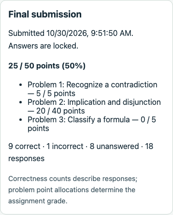

# Assignment scoring: final branch verification

Date: October 30, 2026. Branch: `019-feat-assignment-scoring`. Focused feature verification, not an exhaustive product QA sign-off.

## Automated checks

- `npm run check`: type checks, 975 tests (104 engine, 632 API, 239 web) and production builds passed.
- `npm run db:test`: 212 PostgreSQL checks (155 database, 57 API/workflow) passed without failures/skips. Coverage includes schema comparison, point defaults/bounds, migration preservation/refusal, immutable finals, normal/demo allocation workflows, release/redaction, frozen retries, duplication and demo reset/cleanup.
- Scoring tests cover per-occurrence weights, repeated versions, rounding to hundredths, sum/percentage consistency, zero grades versus pending review, invalid/missing/foreign outcomes, objective report mapping and input immutability. Frontend coverage includes invalid/reverted weights, failed-save retention, weight-only occurrence identity, reordered repeated versions, published/archive locks, score-free controls and pending/released student/instructor views.
- Formatting, branch/working-tree whitespace and local Markdown file links passed. A prior sandboxed check encountered the existing process-watcher file-limit error; the permitted full check and final rerun passed.

The final logs and local browser scripts are ignored under `.codex-local/verification/scoring/`; they are local evidence rather than browser CI.

## Focused real-API Chrome walkthrough

Headless Chrome 156.0.8078.76 used temporary Vite/API processes and a fresh isolated schema in the disposable local test database. API responses were real local responses except one deliberate synthetic 503 used to verify failed-save retention. No Cognito/email or real payment calls were made. The temporary processes/schema were cleaned up; the user's application database and running servers were not used.

Verified:

1. Template 5 seeds a 20-point introductory table and 20/5/5-point mixed graded work. Published point inputs are locked.
2. UI duplication creates an editable draft. An invalid zero allocation disables saving with an explanation. Changing the table to 40 updates the total to 50.
3. One injected save failure retains the new allocation. A real retry preserves occurrence IDs; reordering moves weights with problems and saves 5/40/5. Publication locks the saved weights. The draft fits a 390px viewport without horizontal document overflow.
4. Student UI saves a correct true/false response, half the table's cells correctly, and an incorrect multiple-choice response, then finalizes. The frozen score is 25/50 (50%), with per-item scores 5, 20 and 0. Submission/read responses withhold correctness and score while grades await release.
5. Instructor final lists/detail show the frozen score before student grade release. Revealing answers independently leaves the student's score null. Later grade release exposes the retained point summary and item scores. Submission retry returns the identical score snapshot. The mobile result fits a 390px viewport.
6. Private practice shows no point grade or final-submission action. Reset removes the copied assignment/submission and restores 20/5/5 seeded weights. Browser storage remains empty, logout succeeds and no uncaught page errors occur.

The screenshot shows the released score and raw correctness counts as separate evidence. No claim is made about every layout, assistive technology or browser combination.

## Data and rollout

All graded work uses one point model; there is no assignment opt-in toggle. Each occurrence defaults to 10 whole points, bounded 1–1,000. Practice/completion remain score-free. Final point snapshots are separate from unchanged correctness report formats, protected by existing immutable-final retention. Future review outcomes remain distinct from numeric zero; proof submissions and instructor score adjustments are not enabled.

Run `npm run db:migrate` before starting matching contracts/database-package/API/frontend builds. The branch includes `Migration20261029160000` followed by `Migration20261030120000`; both are needed from main. The latter removes the temporary assignment toggle, preserves explicit allocations/scored snapshots and supplies missing defaults. It refuses existing unscored graded finals rather than silently recalculating official grades. Use a [fresh disposable development database](../development/local-database.md#pre-launch-scoring-reset) when needed. No user database was reset or migrated during verification.

New/reset demo workspaces receive template 5. Existing visitors retain their content until explicit reset, which retains the original absolute expiration. Older application versions cannot interpret all score contracts; database rollback alone does not establish application compatibility. The earlier storage migration refuses rollback while scoring data would be lost. Coordinate API/frontend rollout for weighted request fields and point displays.

## Limits

No fresh clean installation, remote CI query, hosted deployment, live Cognito/email/payment check, load/soak run or accessibility/multi-browser matrix was performed. Existing Jest VM-module advisories remain. Browser evidence focuses on the demo's real scoped APIs; normal-account authorization, completion-only score-free behavior and broader concurrency/retention cases were covered by automated checks rather than separate browser journeys. This is not full product QA.

No infrastructure was provisioned or external messages sent. Instructor overrides/comments, derivation checking/editing, autosave, extra credit and fractional maximum allocations remain outside this branch. No proof grade can yet be submitted; `needs_review` is foundational representation only. Next planned feature: `020-feat-propositional-proof-checker`, starting with explicit rule/structural semantics.

## Review follow-up: assignment form extraction

Extract item-order comparison, point validation/change detection and total calculation to `helpers/assignment-item-state.ts`, and the explanatory/error/total presentation to `AssignmentPointsSummary`. Ordered occurrence IDs are compared directly instead of JSON-stringifying arrays; repeated-version identity remains preserved. The form retains state, callbacks and submission orchestration. All 239 web tests and the frontend type check/production build passed after extraction, including invalid/reverted weights, failed writes, repeated-item reordering and publication locks. Formatting and whitespace checks passed. No API/database behavior changed; broader suites and the browser walkthrough were not repeated for this refactor.
