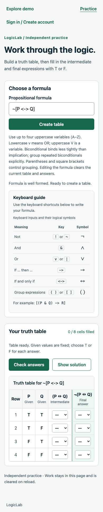

# Biconditional and tilde notation verification

Date: October 29, 2026. Branch: `016-feat-biconditional-support`. Automated/browser checks ran against `a556d9b`; final changes are documentation and screenshot evidence only.

## Behavior

The shared engine accepts `↔` and contiguous `<->` as biconditional (`iff`), true exactly when operand values match. Biconditional has the lowest precedence; repeated biconditionals require explicit grouping. `~` is an alias of `!`/`¬`, with unchanged negation semantics and canonical `¬` labels. Existing formulas retain AST shape and structural row/column IDs. New biconditional columns use canonical `↔` labels under the existing structural-ID scheme.

The keyboard guide and local debounced validator use the new notation. Authoring, preview, publication, stateless checking/solutions and assigned work share the engine; stored formulas remain source text, with no schema migration or regrading of retained work.

## Automated validation

- `npm run check`: type checks, 816 tests (104 engine, 516 API, 196 web) and production builds passed.
- `npm run db:test`: 180 PostgreSQL checks passed (133 database, 47 API/workflow); zero failures/skips.
- Formatting, whitespace and local Markdown targets checked.

Engine tests cover equality truth values, aliases, mixed precedence, explicitly grouped/rejected chains, positioned malformed tokens/delimiters, resource bounds, canonical IDs and intermediate-expression ordering/deduplication. Existing parser/evaluator/table tests remain intact apart from updating the formerly unsupported biconditional case.

HTTP tests verify valid authoring and rejection before storage, consistent ambiguity errors and matching exercise/solution/check IDs. The new persisted demo workflow covers ASCII/Unicode draft updates, unchanged drafts after invalid edits, publication snapshots, redacted exercise previews, private checks without attempt creation, graded 8/8 correctness, score-free completion, assigned solutions and frozen final-result retries. Existing release-policy, billing, isolation and retention suites passed.

Frontend tests cover the keyboard entries, valid grouped notation, delayed feedback, ambiguity hints and disabled creation until grouping is fixed. Browser tests below complement those tests rather than replacing them.

## Focused local Chrome walkthrough

Headless Chrome 156.0.8078.48 used temporary Vite/API processes, an isolated disposable PostgreSQL schema and synthetic demo identities. API responses were real local responses, not intercepted fixtures.

1. Verify `<->` and `~` in the keyboard guide; create `P <-> Q`, fill T/F/F/T and receive four correct cells.
2. Show/hide solutions and recreate with `P ↔ Q`; verify identical exercise data. Compare `~[P <-> Q]` with `¬(P ↔ Q)`.
3. Enter `P <-> Q <-> R`; verify the grouping hint and disabled Create table. Group the expression and create successfully.
4. Verify the practice page at 390px without document overflow; inspect the keyboard guide and canonical intermediate/final columns.
5. In a demo instructor workspace, create `~[P <-> Q]`, preview and show its solution, save the draft and publish version 1 through the UI.
6. Set up and publish an assignment through the API using that version. As the demo student, fill/save all eight intermediate/final cells through the UI, submit for 8/8 correctness and show the assigned solution.
7. Verify empty local/session storage and no uncaught page errors. Temporary servers and schema were cleaned up.

Ignored local scripts/logs/screenshots: `.codex-local/verification/biconditional/`. This is focused evidence, not a committed browser CI suite or exhaustive manual QA. Assignment setup used API fixture calls; the remaining student steps used the browser. Completion-only behavior was verified in integration tests, not an additional browser journey in this pass.

## Rollout and limits

No migration, new environment variable or demo template upgrade is required. Rebuild/deploy matching engine, API and frontend packages together; restart development watchers when needed to avoid old generated outputs. Existing persisted formulas, IDs, saved answers and final snapshots are unchanged.

An older engine cannot parse newly authored biconditional/tilde formulas, so application rollback requires a compatibility plan even though the database schema is unchanged. Do not silently rewrite published snapshots to force rollback. Constants, multi-letter variables, other biconditional spellings and derivation rules remain outside scope. Existing length/variable/nesting bounds remain enforced.

No clean installation, remote CI query, hosted deployment, live Cognito/email/payment verification, load/soak test, screen-reader audit or multi-browser matrix. The portfolio sandbox still follows the remaining conceptual-question feature and UI/visual audit. Existing Jest VM-module advisories remain. No external resources were provisioned or messages sent.
