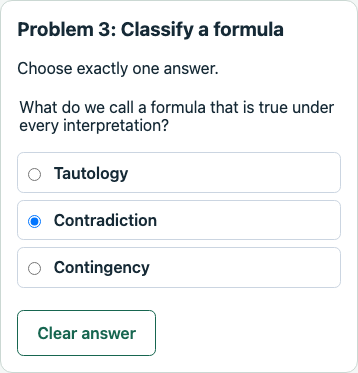

# Conceptual questions: focused demo verification

Date: October 29, 2026. Final verification of `017-feat-conceptual-questions`. This is focused feature evidence, not an exhaustive product QA sign-off.

## Automated checks

- `npm run check`: type checks, 926 tests (104 engine, 595 API, 227 web) and production builds passed.
- `npm run db:test`: 192 PostgreSQL checks passed (139 database, 53 API/workflow), with zero failures/skips. Template-4 coverage verifies seeded mixed practice, transient checks without attempt creation, pinned solution keys/explanations, withheld mixed grades, independent release and finalization retries. Existing reset/cleanup/failed-reset workflows passed with the expanded graph.
- Older-workspace simulation retains edited content, final work and template metadata on authentication. Explicit reset restores the new graph while retaining the original absolute deadline and invalidating old credentials.
- Formatting, branch/working-tree whitespace and local Markdown file targets passed. No schema migration was added.

## Real-API Chrome walkthrough

Headless Chrome 156.0.8078.48 used temporary Vite/API processes and an isolated schema in the disposable local test database. All API responses were real local responses, without interception. Synthetic identities and simulator billing made no Cognito/email or real payment calls. The temporary servers/schema were removed after the run; the user's running app and QA data were not used.

The walkthrough verified:

1. A new workspace has three library problems and three published assignments, with the original graded truth-table example retained.
2. Instructor UI multiple-choice creation, correct-option reordering, isolated draft preview with optional answer/explanation reveal, explicit save and immutable publication.
3. Mixed private-practice automatic checking after a pause, manual checking, status-only responses and no attempt until explicit save. Saved false survives a full refresh after reselecting the class/assignment.
4. Solution/explanation show/hide without replacing selected answers, dirty choice retention across Stay, and a 390px question view without horizontal document overflow.
5. Mixed graded table/choice entry, explicit per-problem saves, final confirmation and submission. Pending-grade read responses contain no result, key or explanation.
6. Answer reveal before grade release, followed by grade release and visibility of the original frozen `mixed_v1` result. Instructor final review shows the frozen conceptual selection/status read-only.
7. Mixed completion-only gating and `mixed_completion_v1` finalization with filled incorrect entries, no correctness data and post-submission solutions. Assignment setup used API fixture calls; answer entry, saves and finalization used the browser.
8. Reset restores template 4, removes authored content/work and leaves browser local/session storage empty. No uncaught page errors occurred.

An initial harness attempt did not reselect the assignment after a full page refresh and timed out; the corrected navigation passed. An initial full-page screenshot captured poorly while scrolling; the replacement below is a stable element capture inspected visually. Neither is recorded as a product failure.

Local scripts/logs/screenshots are ignored evidence under `.codex-local/verification/conceptual/`, not a browser CI suite. This is not exhaustive QA, a screen-reader/keyboard/browser matrix, load/soak verification, a clean-install check, hosted deployment or live Cognito verification. The original signup email-timing issue is outside this slice. Existing Jest VM-module advisories remain. Older applications cannot read new conceptual definitions or mixed results; coordinate rollback rather than rewriting published snapshots.

## Final branch review and rollout

Final tests cover conceptual authoring limits/keys and strict redaction, stable option identity, null versus false, JSON/snapshot retention, immutable publication, normal/demo ownership and enrollment, typed saves/checks, invalid-response rollback, revision conflicts, mixed completion/grading and independent release/retry projections. Existing table-only finalization retains exact `truth_table_v1` / `completion_v1` formats; no historical result is converted or regraded. Frontend coverage includes failure retention, draft replacement protection, stable selection after reorder, immediate-check cancellation, solution isolation, pending-grade receipts and read-only instructor review.

The branch also fixes the reproduced development watcher shutdown failure: Node native watch uses tsx as a loader, and API shutdown has an idempotent ten-second deadline. The committed watcher regression now waits for confirmed child failure before sending the shutdown signal. It passed again after that final test refinement. Earlier process smoke covered actual API health/SIGINT, watcher exit after a child crash, hung cleanup/leaked handles and shutdown during initialization. The original incident's child-death trigger remains unknown; see [development processes](../development/dev-processes.md).

Rebuild matching database-package/contracts/engine/API/frontend outputs before rollout; no migration or new environment variable is required. Restart an existing development session to adopt the new watcher. New demo visitors receive template 4; older workspaces upgrade only on explicit reset, retaining the original absolute deadline. Reset deliberately discards their old synthetic work/content. Coordinate application rollback because older code cannot read conceptual definitions, tagged responses or mixed final formats.

Final automated logs are ignored under `.codex-local/verification/conceptual/final-*.log`. A fresh clean install, remote CI query, hosted deployment, live Cognito/email/payment flow and load/soak run were not performed. Questions use instructor-provided keys; the backend does not verify the instructor's reasoning. Each table cell and each conceptual question contributes one unweighted response unit. Correctness feedback can imply binary answers even when the explicit answer key remains locked. Multi-select, partial credit, rich text, randomized options, notifications and derivations are outside this branch.
