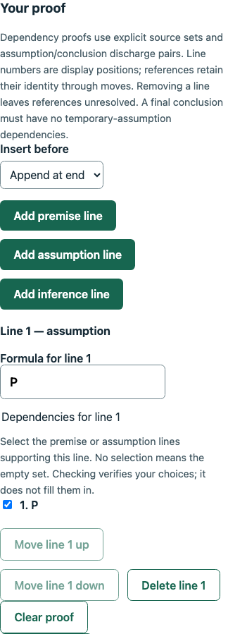

# Dependency proof format: final verification

Date: November 4, 2026. Branch: `025-feat-dependency-proof-format`. Runtime checks cover commit `ca96302` plus this documentation-only closeout. This is focused feature evidence, not exhaustive product QA or a hosted deployment sign-off.

## Automated verification

- `npm run check`: type checks, **1,779 tests** (468 engine, 962 API, 349 web) and production builds passed in the closeout run.
- `npm run db:test`: **304 PostgreSQL checks** (184 database, 120 API/workflow) passed in the closeout run, including schema comparison, existing migrations and normal/demo workflows.
- Built ESM/CommonJS smoke passed both checkers, shared report validation, dependency saved-answer parsing, the existing completion subpath, cross-format rejection and invalid-support rejection.
- Formatting, working-tree/branch whitespace and local Markdown file targets passed during closeout.

Final logs are retained locally under ignored `.codex-local/verification/dependency-proof/closeout/`. Earlier per-slice runs, scripts and limits are recorded in [the implementation record](../planning/dependency-proof-format.md). Repeated executions are not added together to inflate test totals.

An earlier slice's schema comparison found a leftover empty generated `demo_seed_…` schema in the disposable test database. Only that identified empty artifact was removed. The subsequent slice run and final closeout PostgreSQL run passed. The user development database was not migrated/reset. Run schema-comparison tests without unrelated temporary-schema browser/focused tests in flight.

## Checker and contract boundaries

The bounded dependency representation has explicit premise/assumption support sets and assumption/conclusion discharge pairs. Tests exercise exact rule permissions/arity, authoritative premise correspondence, source identity/order, missing/duplicate/invented support, branch-local discharge, vacuous discharge, repeated assumptions, invalid/unknown upstream work, actual final targets, unused mistakes, resource limits and input preservation. Written annotations never become trusted support: the checker computes support from earlier resolved work and compares exact sets.

Dependency and Fitch share formulas, the 19-rule catalog, local inference patterns, budgets, report versions and scoring semantics. Their structure/input/step implementations and editors remain distinct. Existing Fitch-specific exports/schemas still reject dependency input; shared library/saved-work schemas admit the appropriate union. No proof conversion, arbitrary custom rule or new report/result version is introduced.

## Authoring, publication and student workflows

HTTP/PostgreSQL tests cover normal/demo ownership, strict private/public projections, incomplete drafts, matching reference format, current statement/rule certification under the publication lock, immutable versions, edit/publication races and rollback. Public assignment create/update/duplicate/publication admits either or mixed formats while retaining class coverage, policy, published/archive and ownership rules. Repeated occurrences retain independent identities and weights.

Student checks are transient and explicit; they do not create attempts, change revisions, reveal references or award grades. Saves retain incomplete/incorrect work under revision and assignment/enrollment locks. Cross-format or forged/private fields fail without partial writes. Separate reference reveal never changes entries or releases grades.

Graded finals freeze automatic proof evidence and points independently. Accepted proofs earn full allocation; incorrect/incomplete/unassessable work remains pending instructor review rather than receiving zero. Instructor points/comments/history preserve the original automatic evidence and follow grade release. Completion requires a filled attempt ending at the target, allows logical mistakes, and freezes verification flags without a score. Incomplete fields/unknown targets remain unfinished. Retained results, concurrent retries, caller rollback, owner isolation and independent grade/answer release were verified for both normal and demo work.

## Local browser evidence

Focused headless Chrome 156.0.8078.81 used real local APIs and isolated temporary schemas. Temporary Vite/API processes and schemas were cleaned up. Earlier authoring/finalization scripts used a local server-only assignment fixture while admission was intentionally guarded; the final admission journey used public owner/student APIs and the actual picker, with no assignment fixture route.

The browser journeys verified:

- Dependency reference authoring/check/save/publication, reload/private preview, explicit format-discard consent, Stay retention and mobile editing.
- Student incomplete-draft saves/reloads, explicit checks, independent repeated occurrences/references, Stay/Discard and pinned format.
- Graded UI submission/withheld receipt, instructor read-only review and point/comment adjustments, answer reveal before later grade release.
- Filled-but-incorrect completion, retained error flags without points, instructor review and mobile layout.
- Public mixed-format selection, 15/25-point authoring/publication, preserved duplication, student dependency submission and retained review/releases without admission bypasses.
- Template 6 practice/reference access and reset generation fencing/restoration. Browser storage remained empty; no uncaught page errors or horizontal overflow were observed at the checked 390px viewport.

Local scripts/logs/screenshots are ignored evidence, not browser CI. Initial smoke attempts required selector/setup corrections before the passing runs. The screenshot below shows the dependency editor at a 390px viewport with an intentionally unfinished practice proof; it does not demonstrate a completed valid proof.

## Rollout, rollback and limitations

No new migration or environment variable is required. Rebuild/restart matching contracts, engine, database-package, API and frontend outputs. Existing saved Fitch/objective work and retained results are unchanged. Older applications cannot interpret dependency definitions/answers; coordinate rollback rather than converting published snapshots or silently regrading finals.

New/reset visitors receive demo template 6: original table/concept examples plus Fitch/dependency practice, 40-point graded and score-free completion assignments. Authentication/role switching does not upgrade existing content. Explicit reset replaces only that workspace's data, rotates credentials and preserves its original absolute deadline.

The build still warns about the 500.68 kB entry chunk (152.37 kB gzip), just above the unchanged 500 kB threshold. Existing Jest VM-module and Vitest environment advisories remain. No fresh clean installation, remote CI query, hosted deployment, live Cognito/email/payment verification, load/soak run or accessibility/multi-browser matrix was performed. Broad manual QA remains deferred. No infrastructure was provisioned or external messages sent.

Natural-deduction trees, student-created proof practice, truth trees/tableaux, predicate logic, proof search, arbitrary custom rules, automatic format conversion and autosave remain outside this branch. The agreed next feature is `026-feat-natural-deduction-trees`; see [the sequence](../planning/logical-derivations.md#025-and-026-additional-formats).
