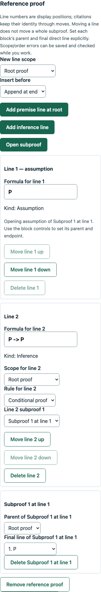

# Derivation authoring: final branch verification

Date: October 30, 2026. Branch: `021-feat-derivation-authoring`. This verifies private instructor authoring and publication, not a released student derivation workflow or exhaustive product QA.

## Automated checks

- `npm run check`: type checks, 1,324 tests (357 engine, 699 API, 268 web) and production builds passed.
- `npm run db:test`: 221 PostgreSQL checks passed (159 database, 62 API/workflow), without failures/skips.
- Formatting, branch/working-tree whitespace and local Markdown file targets passed.
- The public entry is 487.91 kB and the lazy library chunk 58.51 kB; warning thresholds are unchanged.
- The branch adds 67 ordinary test cases and nine PostgreSQL cases over branch 020. Existing scoring, release, billing, authentication, demo, jobs and retention regressions passed.

Contracts cover versioned private definitions, content/reference projections, incomplete drafts, effective-label normalization/collisions, supported identities and strict resource/field bounds. Persistence/HTTP tests cover owner isolation, saved-reference checks, normal/demo scopes, authorization/origin/rate/no-store policies, fresh reference validation under the parent lock, immutable snapshot/history, rollback, concurrent publication numbering and assignment rejection.

Editor tests cover statement and premise identities, explicit rule permissions and alias/custom labels, type-switch isolation, dirty baselines, save failures, archive locks, current/saved report invalidation, valid UI-authored conditional and modus-ponens proofs, insertion/move/citation identities, confirmed deletion, retained missing targets and bounded malformed/duplicate/cyclic data handling. These DOM/helper checks use the real shared proof engine but do not establish browser layout or accessibility behavior.

## Focused real-browser walkthrough

Headless Chrome 156.0.8078.76 ran against temporary local Vite/API processes and an isolated schema in the disposable test database. All owner content was created through the actual UI/API. One failed save was intercepted with a synthetic 503; other application responses came from the real local backend. The walkthrough passed:

1. Create/save an incomplete `P &` premise with no reference; publication rejects the missing reference.
2. Author `P → P` using a one-line assumption subproof, its explicit endpoint, a root conditional-introduction step and custom `CP` label. Both local and saved-server checks accept it; publication pins the exact private proof/labels.
3. Change the target, retain input after Stay and a synthetic failed save, retry successfully, and reject publication against the now-invalid saved reference without consuming another version number.
4. Restore the target and change the effective label without changing version 1. Confirm/cancel reference deletion, discard unsaved deletion, archive/restore, reload and inspect the original private version preview.
5. Inspect the reference editor at 390px width without horizontal page overflow; capture and inspect the screenshot below.
6. Keep derivations out of assignment selection and reject direct assignment creation. A separate visitor and a student role cannot read/check the owner's private proof.
7. Reset removes owner-authored reference snapshots; logout completes, browser local/session storage stays empty, and the successful run records no uncaught page errors.

The first browser runs found two development issues that automated builds/DOM tests had not established: linked CommonJS proof subpaths were missing from Vite prebundling, and nested select labels included option text in exact browser label matching. Explicit dependency entries and `useId`/`htmlFor` label associations fixed them. The UI test now asserts the scope selector's exact accessible name. Failure-simulation and restore-wait assertions were also corrected in the local script; those were harness issues, not application fixes.

Temporary servers and the isolated schema were cleaned up after every run. Scripts/logs are local ignored evidence in `.codex-local/verification/derivation-authoring/`, not browser CI. This is a focused authoring journey, not a full product or accessibility sign-off.

## Delivery and rollout

Private instructor library workflows accept truth tables, true/false, single-answer multiple choice and version-1 Fitch derivations. Combined private contracts live in `@logiclab/contracts/problem-library`; derivation-specific definitions, solutions and saved-check responses live in `@logiclab/contracts/derivation`. The data-only rule catalog is available through `@logiclab/logic-engine/proof/rules`. Node/browser package exports remain explicit; no compatibility re-export or new external dependency is required.

Definitions pin format, catalog/checker semantics, enabled rule IDs and effective labels. Reference proofs and explanations stay private. The form preserves incomplete work and exact reference identities, checks unsaved work only on explicit action and saves explicitly. Publication always rechecks the locked server draft; local/saved preview reports are not acceptance credentials. A reference must be wholly accepted before publication. Later draft changes and archive/restore cannot rewrite a snapshot.

No migration or new environment variable is introduced. Rebuild matching contracts, engine, database package, API and frontend outputs, and restart running development sessions. Existing JSONB columns and snapshot triggers support the new exact JSON types. Older library clients/applications cannot read newly authored derivations: coordinate application rollback rather than rewriting pinned snapshots. The user development database was not migrated or reset.

Assignment/student admission remains guarded in both the picker and server store. Supported historical versions remain selectable even if the current library draft is a derivation. No derivation demo template is seeded; the existing template remains version 5. Browser verification uses disposable owner-authored content.

## Limits and next milestone

No fresh clean installation, remote CI query, hosted deployment, live Cognito/email/payment verification, load/soak run or accessibility/multi-browser matrix was performed. The editor uses flat line cards and explicit block controls; it does not automatically repair order/scope errors or move an entire block when moving one line. Duplicate/colliding reference identities require explicit rebuilding. Render performance at every maximum allowed proof size remains unmeasured. Work budgets bound checker operations rather than wall-clock time. Existing Jest VM-module advisories remain.

No student proof editing/saves/finals, grading adjustments, numerical partial credit, custom inference behavior, other proof formats, proof search, autosave or infrastructure provisioning is enabled. Next is the planned `022-feat-derivation-student-work`; graded derivations stay guarded until the 022–023 student/review milestone is complete.
