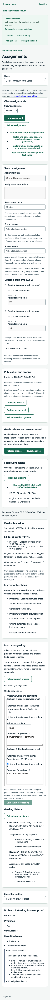

# Instructor grading and derivation review: final verification

Date: November 3, 2026. Branch: `024-feat-derivation-grading-review`. Runtime verification covers commit `8b8ddab` plus the final comment-label fix and documentation pass. This establishes focused graded Fitch and instructor-adjustment workflows; it is not exhaustive product QA.

## Automated checks

- `npm run check`: type checks, **1,585 tests** (377 engine, 880 API, 328 web) and production builds passed in the closeout run.
- `npm run db:test`: **291 PostgreSQL checks** (184 database, 107 API/workflow) passed in the closeout run. Tests use disposable databases/schemas, including migration down/up, schema comparison and retained-history rollback refusal.
- Formatting, whitespace and local Markdown targets were checked during closeout.

The first closeout `npm run check` stopped with a native process segmentation fault while starting the unchanged engine tests. It produced no test assertion failure. The complete rerun passed without a runtime/configuration change; the underlying native crash cause is not established. The failed command log is retained as `final-check-attempt1.log` rather than counted as a successful run.

Ignored closeout logs/scripts are under `.codex-local/verification/grading-review/`. Earlier per-slice totals and actual checks are retained in [the implementation record](../planning/derivation-grading-review.md); the totals above describe the final run rather than adding repeated tests together.

Contracts/calculation tests cover hundredth-point awards and maxima, explicit zero versus pending review, comment-only/null restoration, independent occurrence identity, strict server-owned metadata, malformed state and detached effective scores. Proof reports and automatic point snapshots remain separate from awarded grades.

Database/HTTP coverage includes final-only owner authorization, normal/demo scope and role fences, append-only/sequential history, version conflicts/races, archive locking, caller/database/demo rollback, unchanged original evidence, bounded history pages and workspace-safe reset/cleanup. Public normal/demo journeys exercise weighted proof create/update/publication/duplication, explicit student saves, submission, withheld/released projections, instructor awards and both grade/reference release orders. Existing objective, completion, private practice, billing, authentication, jobs and retention regressions pass.

Frontend tests cover explicit revisioned saves, changed-occurrence payloads, validation, failure retention and mandatory reconciliation, unsaved navigation/selection, archive guards, paginated history/retry/reset, StrictMode/unmount cancellation and late-result rejection. They verify effective list/detail scores, immutable diagnostics, released text comments, authoritative refresh, hidden held feedback and reference independence. No automatic numerical proof partial-credit algorithm is introduced.

## Focused browser evidence

A successful local headless Chrome `156.0.8078.80` journey used real local APIs, temporary Vite/API processes and an isolated PostgreSQL schema. It used the demo resource namespace and actual workspace role/session changes. Normal-account behavior was verified through HTTP/database tests, not live Cognito browser sign-in.

The browser journey verified:

1. Instructor UI creates a Fitch problem with a checked accepted reference and private explanation, publishes it, adds it twice to a graded assignment, assigns 20/10 points and publishes with independent manual grade/answer release.
2. Student UI edits an invalid proof and saves a valid repeated occurrence. Graded draft checks/diagnostics are unavailable. Explicit final confirmation yields a held receipt without reports/points/comments or reference access.
3. Owner review exposes original reports and pending grading. A second real owner API write advances the revision; the browser save returns a real 409 conflict. The draft survives, further saves are disabled, native Stay preserves it, and Discard reloads current grading. The browser then saves partial points/comments and inspects both retained history revisions.
4. Grade release exposes 22.25/30 points and instructor comments on a student read, with the original invalid-proof diagnostics and no reference access. Zero resolves an award; restoring automatic grading reopens pending review. Subsequent corrections follow the already released policy.
5. Separately revealing answers grants the reference/explanation without replacing submitted answers, original reports or automatic points. A final-submission retry returns current authorized grading and the same original evidence.
6. Owner review and student reference/result views pass 390px document-overflow checks. A separate visitor cannot read the grading. Reset succeeds with retained grading history, logout succeeds, browser local/session storage is empty and no uncaught page errors occur.

No API responses were intercepted or fabricated in this run. The deliberate competing revision used the real owner endpoint; its correction was completed through the browser UI. The successful script is `browser.cjs` with `browser.log`; two earlier failed runs are retained as ignored logs. The first needed a selector scoped between the disabled assignment maximum and the grading award. The second exposed an edited textarea label that stopped matching; comment fields now use explicit `htmlFor`/`id` associations. The full journey passed after that fix. Each attempt stopped its temporary processes and removed its isolated schema.

## Delivered boundaries

- Graded Fitch work is publicly authorable/assignable. Accepted proofs receive full automatic points; any mistake, incomplete work or unavailable verification starts pending review. Unused errors still require review.
- Owners can adjust points/comments for any final graded occurrence, including automatically accepted proofs and objective questions. Zero resolves grading; null restores automatic grading. Unresolved occurrences keep effective totals/percentage null.
- Latest grading is the latest immutable revision. History preserves changes, resulting decisions/points, reviewer and database time. Original automatic scores, proof reports, answers and submission metadata remain immutable.
- Student reports/points/comments follow grade release. References follow answer reveal. Held work includes neither grading decisions nor automatic scores; released corrections appear on the next read/refresh/retry. There is no polling/notification.
- Completion verification remains score-free and practice drafts remain private. Only final work appears in owner review. Demo stores join the workspace transaction and fence the current actor; reset/expiry deletion checks attempt/reviewer ownership.
- Seed template 5 is unchanged. Demo proof/grading examples are owner-authored; seeded cross-format journeys remain planned for 027.

## Rollout and compatibility

1. Apply `Migration20261103120000` before starting the matching application. It adds `submission_grading_revisions`, restrictive relations, revision/state checks, final-only owner append validation and immutable-history guards. Existing automatic results/points are preserved without backfill or regrading. Prerequisite proof result storage is supplied by `Migration20261102120000`.
2. Rebuild matching contracts, engine, database package, API and frontend outputs; restart development sessions. There is no new environment variable or demo template upgrade.
3. Do not roll back application code without compatibility review once adjustments exist: older readers omit effective grades/comments and older demo deletion paths do not remove retained grading history. Migration down refuses retained revisions instead of discarding them. No user development database was migrated/reset during this work.

## Limits and deferred work

No fresh clean install, remote CI query, hosted deployment, live Cognito/email/payment check, load/soak run, screen-reader audit or browser/accessibility matrix was performed. Native dialogs were exercised with pointer actions; full focus restoration/keyboard traversal/browser unload behavior is not established. Existing Jest VM-module and Vitest test-environment advisories remain. Local browser scripts are ignored evidence, not browser CI.

Comments are per occurrence, not per proof line. Awards do not certify semantic correctness or alter checker findings. Released binary correctness may imply answers even when the explicit reference/key is locked. No automatic partial credit, extra credit, autosave, repeated final submissions, custom inference behavior, dependency/tree editors, student-created proof practice, proof search, predicates, subscriptions or infrastructure provisioning is introduced. The next planned branch is dependency-style proof format 025, building on the completed grading/release flow.
