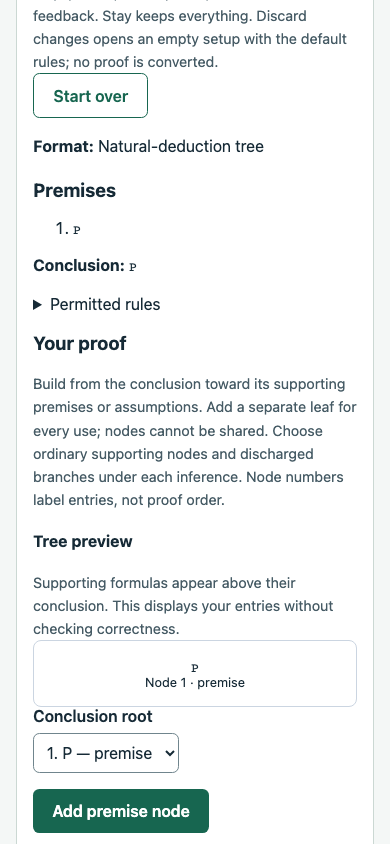
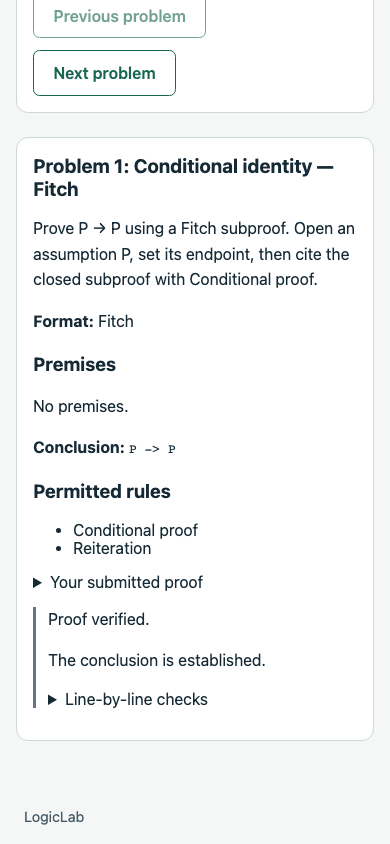

# Independent derivation practice and template 7: verification

Date: November 9, 2026. Branch: `028-feat-derivation-practice-and-demo`. Final runtime checks cover `8d4dd83` plus documentation-only closeout. This is focused feature verification, not full product QA or deployment approval.

## Automated checks

- `npm run check`: workspace type checks, **2,036 tests** (583 engine, 1,051 API, 402 web) and production builds passed.
- `npm run db:test`: **317 PostgreSQL checks** (184 database, 133 API/workflow) passed.
- Repository formatting, branch/working-tree whitespace and local Markdown file targets are checked during closeout. Local PR/smoke scripts and logs remain ignored by Git.

There are 29 new frontend cases and two new API/PostgreSQL cases. Tests cover setup validation, all formats, explicit checks, stale-report clearing, rule permissions, anonymous route access, all six format transitions, same-format restart/no-op, Stay/cancel, discarded setup/errors/rules, clean reset, remount loss and unload registration. Database checks cover certified seeds, longer alternate proofs, private checks without attempt writes, pending/adjusted grading, original evidence/retries, score-free incorrect completion, independent references, v6-shaped retention/reset, lifetime preservation and visitor isolation.

Logs are retained locally under `.codex-local/verification/derivation-practice/`. Slice-specific evidence is in [the implementation record](../planning/derivation-practice-and-demo.md). Counts are final suite totals, not sums of repeated runs. Existing Jest VM-module advisories remain.

## Practice behavior and boundaries

Independent `/practice/proofs` is publicly accessible and lazy-loaded through the Practice page. Setup validates bounded propositional syntax and catalog permissions without requiring a reference solution. A valid statement is fixed after starting; the existing student editors/checkers handle Fitch, dependency and natural-deduction trees. No account/demo API client, grade, instructor-visible record, database save or browser-storage backup is created by this activity.

Checks run only on explicit request and apply to the current entered proof. Edits clear old reports. A failed check says nothing about whether another proof of the selected target exists. Entered setup and active work register with shared navigation/unload protection. Staying or canceling a reset retains the work/report; confirmed format change or Start over discards premises, target, rule choices, proof identities/content, editor state and feedback. The selected format opens a fresh setup with default rules. An untouched blank setup can change format freely. Assigned formats, saves and server disclosure remain separate.

Template 7 adds a checked tree version of conditional identity alongside the existing Fitch/dependency examples. Conditional proof and optional Reiteration permit minimal and longer routes. All three appear in assigned practice, graded (20 points each, 60 total) and score-free completion. Existing table/conceptual examples and six-assignment structure remain. Authentication never silently upgrades a retained visitor; explicit reset restores the new graph, rotates credentials/generation and retains the original absolute deadline.

## Real local browser smoke

Headless Chrome **156.0.8078.81** used temporary Vite/API servers and a disposable local PostgreSQL schema. All requests used real public routes. Both servers and the schema were cleaned up after each attempt. The completed run passed:

- Self-created premise `P`/target `P` practice in all three formats, explicit accepted checks, error recovery and feedback removal after edits.
- 390px views without observed document overflow; reset modal focus inside the dialog, Escape preserving work and confirmed full reset to an empty selected-format setup. This is not a comprehensive focus/keyboard audit.
- A real Chrome `beforeunload` warning and accepted reload clearing page-only work.
- Student UI construction/check/save of all three seeded `P → P` proofs, reload of saved work and separate reference display.
- Graded UI finalization with withheld-grade receipt, instructor UI points/comments and grade release, a released 52.5/60 score while references remained locked, later answer reveal and immutable submission retry.
- Completion UI finalization with two verified proofs and one filled-but-incorrect tree in the response's score-free verification flags; submitted proof review and mobile layout.
- Explicit demo reset rotating generation/user, a separate browser visitor retaining its workspace generation, empty local/session storage and no uncaught page errors.

Assigned practice proofs were entered through the UI. Graded/completion saved-proof setup used public APIs with reference data fetched under the authorized instructor identity, then deliberately made one tree incorrect; final submission and instructor grading used the UI. Answer-release setup used the public API and reference display used the UI. No intercepted/synthetic response or private fixture endpoint was used. Original-deadline preservation and retained v6-shaped upgrade behavior were verified in database tests, rather than inferred from browser-visible session fields.

Early smoke attempts needed a corrected Fitch selector and an explicit wait for reset's credential-rotation response. These were script corrections; no application fix was needed during closeout. The ignored scripts are local evidence, not browser CI.

## Rollout and remaining work

No migration or new environment setting. Rebuild/restart matching workspace packages/API/frontend. New visitors receive template 7; existing demo visitors must explicitly reset to replace their graph and load the new examples. Published proof/result formats and independent grade/reference policies are unchanged. Downgrading a template does not remove already-published visitor content; review older application compatibility before rollback.

No fresh clean installation, remote CI query, hosted deployment, live Cognito/email/payment check, load/soak run or assistive-technology/multi-browser matrix was performed. Simple 390px examples do not establish large-proof usability. Page memory is intentionally lost on reload/remount; browser unload prompts are not guaranteed recovery. No user development database was migrated/reset, infrastructure provisioned or PR published. The agreed UI/visual audit and proof-editor interaction redesign remain required before sandbox deployment; see [the audit plan](../planning/ui-ux-audit.md).
