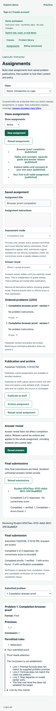

# Derivation student work: final branch verification

Date: November 2, 2026. Branch: `022-feat-derivation-student-work`. Runtime checks cover commit `da609f5` plus the final documentation pass. This establishes focused Fitch practice/completion workflows and guarded graded foundations, not exhaustive product QA or live graded-proof availability.

## Final automated checks

- `npm run check`: type checks, **1,471 tests** (377 engine, 790 API, 304 web) and production builds passed.
- `npm run db:test`: **266 PostgreSQL checks** passed (174 database, 92 API/workflow), without failures/skips. Tests use the configured disposable test database; fixtures create and clean isolated schemas.
- Formatting, whitespace and local Markdown file targets were checked during closeout.
- Final browser entry: 495.60 kB (151.10 kB gzip), with the existing chunk warning threshold unchanged. The completion-readiness chunk is 9.79 kB; student and instructor assignment pages remain lazy-loaded. These are emitted sizes, not measured network/loading performance.

The final automated commands were repeated during closeout. Ignored logs live at `.codex-local/verification/derivation-student-work/final-check.log` and `final-db.log`. The per-slice implementation record retains earlier test totals and boundaries; earlier counts are not presented as the final result.

Contracts and pure tests cover proof response/result versioning, exact database JSON symmetry, bounded incomplete saves, finished versus verified attempts, wrong premise/nonfinal syntax/citation mistakes, target aliases, independent occurrences, strict counts, redaction and rejection of injected evidence/keys/scores. The lightweight `/proof/completion` entry shares readiness logic between browser and server without using inference correctness as a completion gate.

Persistence/HTTP tests cover enrollment/ownership, pinned publications, revision conflicts, independent transient checks/references, no check writes, immutable finals/retries, final-only owner completion review and private practice drafts. They exercise caller/database/demo rollback, concurrent save/finalize snapshots, observed archive/enrollment lock waits, independent answer policies, foreign owners and cross-visitor isolation. Key suites include `derivation-draft-work.test.ts`, `derivation-student-http.test.ts`, `derivation-assignment.test.ts`, `derivation-completion-work.test.ts` and `tools/db/test/proof-result-persistence.ts`. Existing objective, scoring, release, billing, authentication, jobs, demo and retention regressions passed.

UI/hook tests cover stable line/block/citation editing, repeated occurrences, dirty baselines, explicit saves and failure retention, manual-only proof checks in mixed immediate practice, cancellation/late-response guards, navigation protection, independent references, final confirmation, score-free completion and readonly review. Verification-unavailable flags are distinct from errors; neither becomes a numerical grade. Internal graded cases verify full credit versus null pending-review totals and grade-release redaction without enabling owner graded-proof admission.

## Focused browser evidence

Two local headless Chrome journeys used real APIs, temporary API/Vite processes and isolated disposable PostgreSQL schemas. Browser evidence was collected in implementation slices 10 and 14, not repeated during the documentation-only closeout. No intercepted synthetic API responses were used in these proof journeys.

1. **Practice journey (slice 10):** Instructor UI proof authoring/check/save/publication, practice picker and repeated versions, covered publication, role switching, explicit student checks, unfinished proof save/reload, independent reference reveal, Stay/Discard, separate occurrences, hard reload, no practice final submission, 390px overflow check, foreign visitor denial and logout.
2. **Completion journey (slice 14):** Instructor UI authoring/publication and completion assignment publication with two proof occurrences. Student UI entered a finished incorrect proof and a valid proof, saved explicitly and confirmed finalization without any draft proof diagnostics/check request. Submission returned score-free completion with one verified proof and one with errors. Post-submission diagnostics and actual frozen work were visible in read-only student/owner views. The instructor separately revealed references; the student's completion/result remained unchanged. The 390px overflow check passed.

Both successful scripts checked empty browser local/session storage and no uncaught page errors, then stopped their temporary servers and removed their isolated schemas. Slice 14 used Chrome `156.0.8078.76`. Ignored scripts/logs are `slice10-browser.cjs`/`.log` and `slice14-browser.cjs`/`.log` under `.codex-local/verification/derivation-student-work/`; these are local evidence, not browser CI.

The completion browser run caught a development-only import failure that build/DOM checks had missed: the linked CommonJS `/proof/completion` entry needed an explicit Vite prebundle entry. That entry was added and the entire completion journey passed on rerun. A published-assignment label mismatch in the local script was corrected separately; it was a harness selector issue.

## Delivered behavior and release boundary

- **Practice:** Published Fitch problems can be assigned, edited and explicitly saved; Check proof evaluates transient work without writes. Proofs never auto-check, even with immediate-feedback companions. Practice remains private and has no final submission or official grade.
- **Completion:** Admission requires submission-time feedback. Every occurrence must be finished and saved before confirmation; logical errors can remain. Finalization freezes actual reports and verified/error/unavailable flags without points. Owner review sees final work only; diagnostics do not infer effort or revoke completion.
- **Reference reveal:** Student content/checks/review exclude the private reference/explanation. The solution endpoint independently enforces answer policy; authorized reveal does not overwrite entries or release other results. Practice supports never/anytime, completion supports the existing independent submission/instructor policies.
- **Graded foundation:** Internal finalization freezes mixed evidence and points atomically, with full credit only for accepted proofs and unresolved null totals otherwise. Grade withholding still applies. Owner graded-proof admission and grading/adjustment/review remain guarded until 024; fixtures are not a supported user-facing rollout path.
- **Demo:** Normal/demo resource scopes share behavior with workspace-bound transactions and generation fencing. Template 5 is unchanged; proofs are owner-authored examples, not seeded content. Student-created practice and seeded proof demos remain planned work.

## Rollout and compatibility

1. Apply `Migration20261102120000` before running the new application using the normal `npm run db:migrate` process. It extends scored-result constraints for `proof_mixed_v1` and requires that result's point snapshot; existing objective results/points are preserved. Completion uses existing score-free constraints and needs no separate migration.
2. Rebuild matching contracts, logic engine, database package, API and frontend outputs. Restart development sessions so Vite adopts the explicit `/proof/completion` prebundle entry. No new environment variable is required.
3. Keep graded proof authoring/admission guarded. Use normal owner authoring for practice/completion examples; do not populate live graded fixtures before instructor review is available.

The migration's down path locks the table and refuses retained `proof_mixed_v1` data. A successful schema rollback alone does not establish application compatibility: older readers cannot parse saved proof responses or `proof_completion_v1` results either. Coordinate rollback without rewriting immutable publications/finals. No user development database was migrated/reset by the agent, no seed template was upgraded and no external resource was provisioned.

## Limits and next work

No fresh clean installation, remote CI query, hosted deployment, live Cognito/email/payment verification, load/soak run or accessibility/multi-browser matrix was performed. Local Chrome checks and jsdom tests do not establish every focus, keyboard, screen-reader, native unload or maximum-size rendering behavior. Existing Jest VM-module advisories remain. Completion verification is feedback, not misconduct detection; checker work budgets are deterministic operation limits, not wall-clock guarantees.

No live graded proof admission, instructor awarded-grade/comment adjustment, numerical automatic proof partial credit, autosave, custom inference behavior, dependency/tree format, student-created proof practice, proof search, predicates or truth trees is introduced. Next is the agreed `023-refactor-explicit-context-assembly`, preserving behavior and normal/demo transactions, followed by `024-feat-derivation-grading-review`. Final review/CI and merging remain user-controlled; this record does not publish a PR or start another branch.
