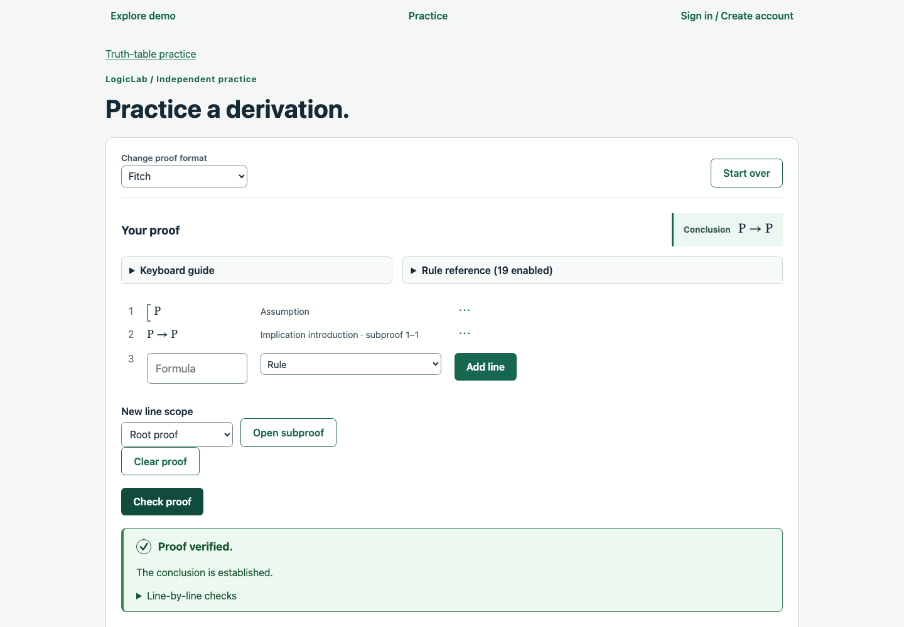
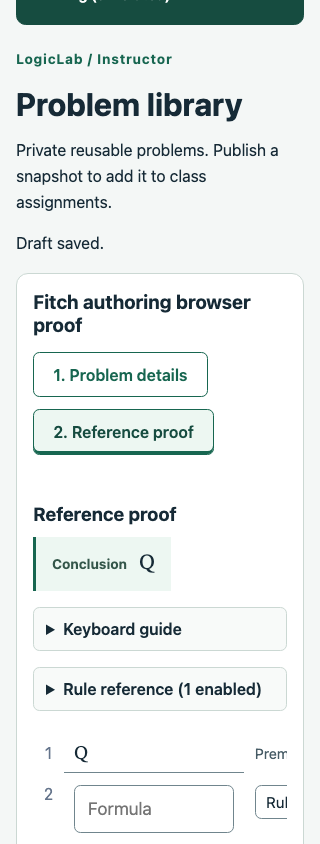

# Fitch proof UI verification

Branch: `030-chore-fitch-proof-ui`. Application checkout: `d848785`, plus documentation-only closeout. Final checks recorded November 11, 2026; focused browser evidence was captured November 10.

## Scope and behavior

Fitch now uses a growing visual proof, confirmed next-line entry, line-action menus and focused subproof controls across the shared practice, instructor-reference and student editors. The display follows actual entered block ancestry/endpoints; closing a subproof does not assert scope, discharge or logical correctness. The checker remains authoritative.

An untouched next row is clean. Edited entries and newly staged assumptions/blocks remain local until **Add line**, or are dropped with **Discard entry**. Pending entries block checking, saving and final submission and participate in existing navigation protection. Existing confirmed-line edits remain immediate local draft changes. Captured base identity prevents a pending entry from replacing reloaded work.

Read-only submitted work, instructor review, private references and authorized solutions reuse the display without editor controls. Missing citations/endpoints remain explicit; malformed scope walks are bounded, and ambiguous identities retain a noninteractive fallback.

Instructor Fitch authoring now shares the dependency details/reference flow, confirmed premise builder and grouped rule-label controls. Sources seed once, IDs survive navigation, successful saves retain the selected step, and changed statement sources require an explicit warning/Keep/Restart decision. Incomplete drafts remain saveable; incomplete statements cannot start reference construction. Archived viewing does not seed work. Trees retain their existing authoring/editor flow for 031.

## Final automated checks

- `npm run check` passed: type checks, **2,202 tests** (587 engine, 1,051 API, 564 web), and production builds.
- `npm run format:check`, working-tree/branch whitespace and changed-branch local Markdown targets passed.
- Existing Jest VM-module advisories remain. No build-warning threshold or test configuration was changed.

Ignored final log: `.codex-local/verification/fitch-proof-ui/check.log`. Tests cover pending-work retention and gating in practice/authoring/assigned work; explicit checks and independent answer reveal; nested close/reopen; safe parent/end choices; scoped insertion before assumptions; missing citations; modal deletion/Keep; deletion following stable identity after an authoritative reorder; orphan-block repair; malformed read-only work; incomplete/failed saves; archived locks; statement/reference alignment and successful-save step retention. Shared dependency and existing tree workflows remain covered.

No API, persistence, contract or database schema code changed, so the full PostgreSQL suite was not repeated for this branch. The focused authoring browser run below used real local APIs and an isolated disposable PostgreSQL schema; it is not a substitute claim that the entire database suite ran.

## Focused browser evidence

The practice runs under `.codex-local/ui-audit/030/confirmed-entry/` and `menus-subproofs/` checked a conditional proof through staged assumptions/inferences, explicit endpoints and accepted checking, pending check gating, Stay/Discard, native menus, focused settings/Escape, close/reopen scope, deletion Keep/focus restoration and desktop/390px/320px bounds. Signed-out bootstrap responses were intercepted; proof construction/checking used the actual frontend/engine, with no proof API calls. A real 320px overflow finding was fixed by anchoring hidden table headers inside the scroll container. A later CSS-only specificity fix preserves spacing around entry controls.

The authoring run under `.codex-local/ui-audit/030/authoring/` used **real local demo APIs** and an isolated disposable schema, without response interception. It checked confirmed premise entry/no phantom source, grouped rule selection, separate reference workspace, accepted reference checking, explicit save/remount, publication/read-only reference, mismatch Keep/Restart, original immutable version versus revised draft, mobile bounds and no uncaught page errors. Temporary servers, Chrome processes and the schema were cleaned up. Desktop proof, desktop details, mobile reference and modal captures were visually inspected during implementation.

These are earlier focused slice runs against the application changes, not a repeated full browser sweep at closeout. Ignored scripts/logs/screenshots are local evidence, not browser CI. The tracked screenshots preserve representative evidence in fresh clones.

## Rollout, limits and next work

Rebuild/deploy the frontend to adopt these controls. No migration, environment change or demo-template reset/upgrade is needed. Existing normal/demo routes use the shared components. Saving/checking/submission, immutable versions/results, grading and independent grade/reference disclosure retain their existing semantics; no source or citation is silently repaired.

The user deferred their visual QA until the general audit after trees. This is focused feature/regression verification, not exhaustive product QA or accessibility conformance. No fresh clean install, remote CI query, hosted deployment, live Cognito/email/payment verification, screen-reader/multi-browser matrix or load/soak run was performed. Live assigned-student and instructor-review browser journeys were not repeated for 030; their changed shared components have automated coverage. No user development database was migrated/reset, infrastructure provisioned or external messages sent.

Next: `031-chore-tree-proof-ui`, then `032-chore-ui-ux-audit` and portfolio sandbox preparation. See the [UI plan](../planning/ui-ux-audit.md), [audit record](../qa/ui-ux-audit.md) and updated [Fitch walkthrough](../development/demo-walkthrough.md#optional-author-and-assign-a-fitch-derivation). The assignment-list/settings/content-view backlog remains planned. This record does not start another branch or authorize deployment.
