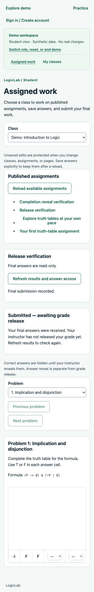

# Independent grade release and answer reveal verification

Date: October 29, 2026. Branch: `015-feat-instructor-controlled-results-release`.

## Result and scope

Graded assignments have independent grade-release and answer-reveal policies/actions. Completion-only acknowledges completion immediately and has only answer-reveal controls. Private practice keeps its existing assistance rules. This is focused branch verification for the planned portfolio sandbox, not full product QA or a hosted release sign-off.

## Automated checks

- `npm run check`: type checks, 783 tests (83 engine, 510 API, 190 web) and production builds passed.
- `npm run db:test`: 179 PostgreSQL checks passed (133 database, 46 API/workflow), with no failures/skips.
- Formatting, whitespace and local Markdown targets checked.

Migration tests cover unchanged legacy graded/completion/practice rows, schema comparison, safe down/up, invalid/partial release metadata, independent action order and refusal of lossy rollback. Existing result snapshots are not rewritten. A final rerun exposed a test that selected the first seeded class instead of the intended class; it now selects the funded example by name, removing dependence on list order.

API coverage verifies owner/enrollment boundaries, normal/demo isolation, pending-grade redaction on submission/retry/read, retained instructor review, explicit-check/solution gating, late submissions, concurrent release/submission, idempotency, preserved archive history, cleared duplication history and demo reset after release. Graded evaluation stays frozen; completion results remain score-free.

UI coverage verifies independent dirty/save state, failed saves/releases, mode transitions, legacy completion assistance, published locks, confirmation/cancel/retry, archived/busy/released controls, normal/demo resource paths and student refresh with independently available answers. Final copy refinement keeps completion-only confirmation/success text about completion rather than grades.

## Local Chrome walkthrough

Headless Chrome 156.0.8078.48 used temporary Vite/API processes, a disposable PostgreSQL schema and synthetic demo identities. It exercised the real local handlers/stores, not intercepted API responses:

1. Create and publish a graded assignment through the UI with both policies instructor-controlled. Verify publication locks the selectors.
2. Submit as the same workspace's student. Inspect the submission response: `result: null`, `gradePending: true`; see receipt without grade summary or solution access.
3. Verify the pending state at 390px without document overflow.
4. Reveal answers first as instructor. Return as student: grades remain pending and assigned solutions become available.
5. Release grades separately. Return as student: the retained result becomes visible.
6. Create/publish a completion-only fixture through the API, save every expected cell and submit. Verify immediate `completion_v1`, no pending grade, no instructor grade selector/action, and independently revealed solutions in the UI.
7. Reset the workspace and verify empty browser storage and no uncaught page errors. Temporary processes and schema are cleaned up.

Local smoke scripts, logs and screenshots: `.codex-local/verification/results-release/` (ignored, not a browser CI suite). The completion setup deliberately used API fixture writes; it was not a complete manual completion-authoring journey. Existing automated tests cover the inverse release order and failed requests; those are not claimed as additional browser journeys here.

## Rollout and limitations

Apply `Migration20261029120000` before running the updated application, then use matching contracts/API/frontend builds. The migration adds release fields with inert submission-time defaults and nullable history; it preserves historical policies, results and answer access. Existing completion checking policies remain available as legacy behavior. New completion authoring uses submission acknowledgement. No demo template upgrade is required; seeded defaults retain submission-time grade/answer behavior.

Rollback refuses instructor-controlled policies, release history and submission-time completion policies that older code cannot represent. Application rollback must be coordinated too; older strict response schemas do not understand the additive fields. Do not silently clear history or coerce policies to force rollback.

Releasing graded per-cell correctness can reveal binary answers by inference even when the explicit answer key is hidden. Independent controls govern disclosure through LogicLab; they cannot prevent external solvers. Release is irreversible and assignment-wide, including later submissions; no automatic release, notifications or polling were added.

No clean installation, remote CI query, hosted deployment, live Cognito/email/payment check, load/soak run, screen-reader audit or multi-browser matrix. The focused browser smoke is not exhaustive QA. Existing Jest VM-module advisories remain. No external resources were provisioned or messages sent.
