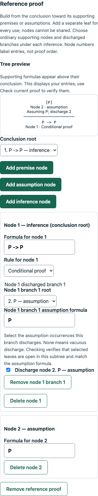

# Natural-deduction trees: final verification

Date: November 6, 2026. Branch: `026-feat-natural-deduction-trees`. Final runtime checks cover commit `ae5f7b4` plus this documentation-only closeout. This is focused feature verification, not exhaustive product QA or deployment approval.

## Automated verification

- `npm run check`: type checks, **2,007 tests** (583 engine, 1,051 API, 373 web) and production builds passed.
- `npm run db:test`: **315 PostgreSQL checks** (184 database, 131 API/workflow) passed, including schema comparison, existing migrations and normal/demo regressions.
- Built Node ESM/CommonJS smoke passed accepted proofs in all three formats, report-schema validation, input preservation, cross-format rejection, invalid discharge, unsupported version handling, tree definition/saved-answer parsing, completion subpaths and the ordinary formula parser.
- Formatting, working-tree/branch whitespace and local Markdown targets were checked during closeout. The local PR draft remains ignored by Git.

Final logs are under ignored `.codex-local/verification/tree-authoring/closeout/`. Earlier focused checks and their staging boundaries are recorded in [the implementation record](../planning/natural-deduction-trees.md). Repeated runs are not added together to inflate totals. Existing Jest VM-module advisories and the Vite 501.79 kB entry warning remain; the size threshold was not raised.

## Representation and checker boundaries

Trees use bounded flat UUID-identified nodes and a selected conclusion root. Premise/assumption leaves support inference nodes through ordinary children or explicitly discharged branches. Repeated uses have separate occurrences; a node cannot be shared between branches. Each discharge names its supporting subtree, assumption formula and the open leaf occurrences it closes. Multiple matching occurrences and vacuous discharge are supported; equal formulas do not merge identities.

The iterative adapter checks identities, connectivity, cycles, shared children, authoritative premises and branch-local open support before accepting a proof. Rule matching uses the existing 19-rule propositional catalog. Local correctness and invalid/unknown support remain separate, including after an earlier mistake. Acceptance requires the selected root to establish the target with no open assumptions and an error-free submitted tree. Detached mistakes cannot be hidden by choosing another root. Input/diagnostic/work limits produce explicit unassessable reports rather than partial acceptance, a zero grade or a claim that the goal is unsolvable.

Fitch/dependency checkers and specific schemas retain their own format boundaries. Shared library/saved-work unions dispatch by the pinned format. Existing report/result/score versions remain unchanged. Added inline comments explain dense traversal, scope, discharge and completion logic; a parsed-token comparison confirmed that the comment pass itself changed no executable code.

## Authoring, persistence and assessment

Owner drafts preserve unfinished work. Publication rechecks the exact saved tree reference against its statement, rules and labels under the existing lock. Immutable versions keep private references/explanations; ordinary student content excludes them. The tree editor/reference preview uses stable IDs, explicit support/discharge controls, visible unresolved selections, confirmed deletion/format reset and existing unsaved-work protection. Drawing a tree does not check correctness.

Student checks are explicit, including under immediate timing, and do not create/save attempts or award points. Revisioned saves preserve incorrect/incomplete work, repeated occurrences and transactional rollback. New format-aware read-only views display submitted work and separately authorized references without overwriting entries. Public create/update/publication/picker paths admit trees under the existing ownership, policy and coverage rules; duplication continues through those shared pinned-version paths.

Graded finals freeze proof evidence and automatic points: verified proofs receive full allocation; other statuses remain pending instructor review. Instructor points/comments/history preserve original answers, reports and automatic scores. Grade release controls graded reports/points/comments independently from reference reveal. Completion requires a filled connected attempt and matching root, while logical mistakes remain eligible for score-free completion with retained verification flags. Missing fields and invalid structure block completion atomically.

Tests cover all catalog variants and direct-rule parity, nested/repeated/vacuous assumptions, malformed/unfinished work, wrong-format/forged fields, occurrence identity, private checks, concurrent saves/finalization, failed transactions, immutable retries, owner/workspace isolation, released grading adjustments and independent answer access. Pure finalization tests mix all three proof formats; PostgreSQL cases pair tree or dependency work with Fitch/objective items in normal/demo scopes.

## Local browser evidence

Focused headless Chrome 156.0.8078.81 used real local APIs and disposable isolated schemas. Temporary Vite/API processes and schemas were cleaned up. Early student-draft work used a private assignment fixture while public admission was guarded. The final graded/completion journey created and published assignments through public APIs, with no fixture route.

The recorded journeys cover:

- Instructor tree reference construction, explicit local/saved checks, save/publication/reload, private previews, format cancellation and deletion repair.
- Student tree construction, manual-only checks under immediate timing, invalid draft save/reload, pinned format, repeated occurrences, independent reference display and Stay/Discard retention.
- Public graded/completion assignment creation/publication, student UI finalization, withheld-grade receipts, retained read-only instructor review and frozen retries.
- Instructor UI points/comments, grades released while references remained locked, later independent answer reveal, and score-free completion error flags.
- 390px editor/review layouts without observed page overflow, empty browser storage and no uncaught page errors in the checked journeys.

Ignored scripts/screenshots are local evidence, not browser CI. Initial script attempts needed setup/selector corrections before the passing runs. The image shows the instructor reference editor with an entered identity tree at 390px; the drawing alone is not proof certification.

## Rollout and limits

No new migration, environment variable or demo template is introduced. Rebuild/restart matching contracts, engine, database-package, API and frontend outputs. Existing Fitch/dependency/objective content and retained results keep their formats. Older applications cannot interpret tree definitions/answers; coordinate rollback without converting published snapshots or silently regrading official work.

Template 6 remains unchanged, seeding Fitch/dependency examples only. Demo instructors can author trees manually now. Student-created proof practice and remaining tree/cross-format seed work belong to proposed `027-feat-derivation-practice-and-demo`; see [the agreed sequence](../planning/logical-derivations.md#027-student-created-practice-demo-and-feature-verification). The required UI/proof-interaction audit still precedes sandbox deployment.

No fresh clean installation, remote CI query, hosted deployment, live Cognito/email/payment verification, load/soak run or accessibility/multi-browser matrix was performed. The simple checked mobile trees do not establish large-tree usability. Broad manual QA remains deferred. No user development database was migrated/reset, infrastructure provisioned, external messages sent or PR published by the agent. Truth trees/tableaux, predicates, arbitrary custom rules, proof search, automatic conversion and autosave remain outside scope.
