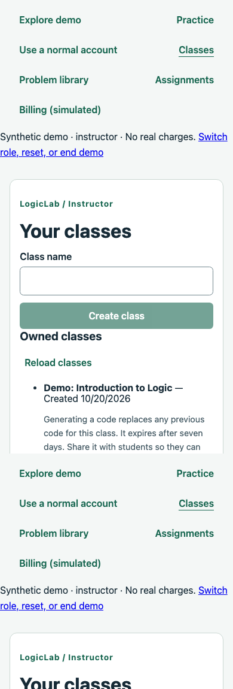

# Isolated public-demo foundation verification

Verification date: October 20, 2026. Branch: `009-chore-public-demo-and-portfolio`.

This verifies a locally runnable demo foundation, not a hosted release. Frontend/API/database hosting, an installed cleanup trigger, and published portfolio links remain pending.

## Automated checks

- `npm run check`: passed type checks, 590 tests (71 engine, 452 API, 67 frontend), and production builds.
- `npm run db:test`: passed 138 PostgreSQL integration checks (103 database, 35 API/workflow tests).
- `npm run format:check` and `git diff --check` against both the working tree and main: passed.
- Local PR draft path is ignored by Git. Markdown link targets in the reviewer documentation were checked locally.

Database tests cover workspace lifetime/identity constraints, migrations, immutable-data retention guards, session rotation, normal/demo separation, activity throttling, absolute expiration, and generation rechecks after lock contention. Seed/reset tests exercise real simulator coverage and publication, frozen submissions, graph replacement, cross-workspace rejection, rollback, and concurrent reset/write fencing.

HTTP integration tests cover opt-in registration, exact origins, separate cookies, lifecycle/resource routes, normal/other-workspace invitation isolation, concurrent capacity enforcement, and a commit failure that must not send a success response. Existing normal account/resource regression tests also pass; this is not a new live Cognito verification.

Cleanup tests exercise bounded concurrent deletion, abandoned provisioning/reset recovery, locked-row skipping, activity extension, retained ordinary/shared/audit data, cancellation before execution, and whole-batch rollback on unsafe references. Operator tests cover disabled schedule setup, preserved edits, manual enqueue deduplication, ten-workspace execution bounds, durable run counts, and subsequent backlog removal.

Frontend regression tests also verify unchanged generic transport paths, explicit normal/demo client destinations, and retained-client scope after navigation/unmount.

## Repeated local Chrome walkthrough

The final pass used the Vite frontend and real API with a unique temporary PostgreSQL schema. It verified:

1. Starting as instructor and creating a class.
2. Switching to the student in the same workspace and submitting the seeded assignment.
3. Reloading and restoring the same workspace/student session.
4. Resetting to generation two and confirming the created class disappeared.
5. A 390px class layout without horizontal document overflow.
6. Empty local/session storage, no uncaught browser page errors, and logout returning an unauthenticated demo session.

The temporary API schema and local servers were removed/stopped afterward. The smoke script remains ignored under `.codex-local/verification/`; it is local evidence, not a CI browser regression suite. This final browser pass did not cover every authoring/billing control, instructor submission review, multiple simultaneous browser visitors, other browsers, or a screen-reader audit. Automated workflow tests cover additional server behavior.

## Rollout and remaining work

Apply committed migrations with `npm run db:migrate`. Demo routes default off; enable explicitly following [local setup](../development/public-demo.md). Normal Cognito configuration remains independent. No Cognito users, emails, external payment calls, AWS resources, or public deployment were created by this verification.

Cleanup schedule setup is disabled by default. Explicitly enqueue work or enable its schedule and invoke scheduler/worker cycles; enabling the API demo flag alone installs no automation. Deletion and job-history completion are separate transactions, so interruption can leave incomplete counts even though idempotent cleanup retries are safe. Cancellation is cooperative, not a hard process kill.

No clean dependency installation, remote CI query, installed scheduler trigger, hosted availability test, load/soak test, or current hosting cost comparison was performed. Vite reports an approximately 842 kB application chunk warning; Jest emits its expected experimental VM-modules warning. Production/shared rate limits and resource budgets still need deployment design. Historical migration SQL includes the explicitly requested readability pass; this branch is not exclusively additive migration text.

Continue with a small hosting-design slice: settle persistence, same-origin routing, cold starts, scheduler invocation, and a spending ceiling before provisioning or publishing. See the [reviewer walkthrough](../development/demo-walkthrough.md) and [architecture overview](../architecture/overview.md).
