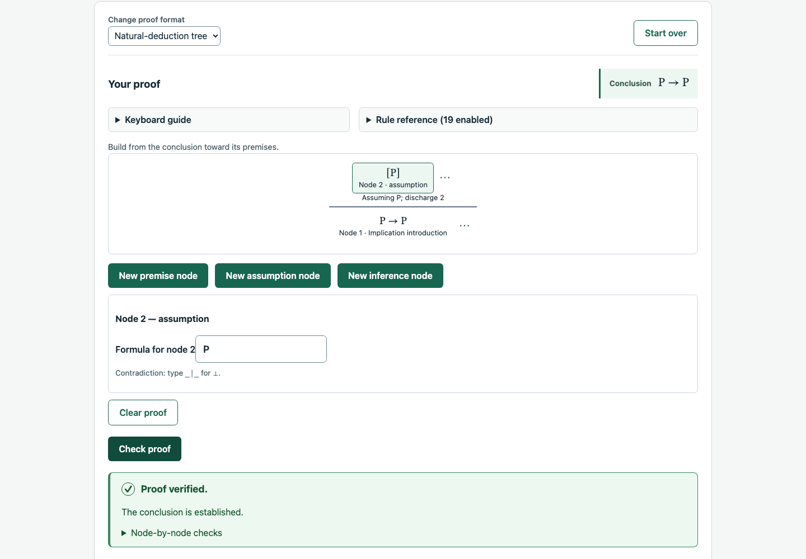
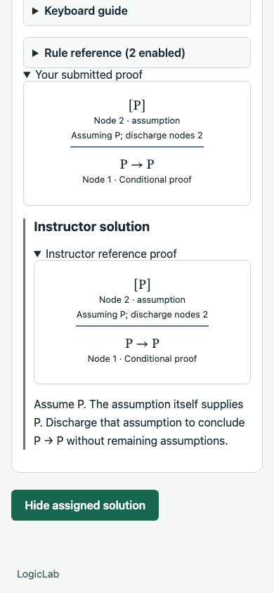

# Tree proof UI verification

Branch: `031-chore-tree-proof-ui`. Application checkout: `a6934ab`, plus documentation-only closeout. Checks and focused browser evidence recorded November 11, 2026.

## Scope and behavior

Natural-deduction trees now show a visual proof and one selected node's fields across independent practice, instructor references and assigned student work. Connected and unattached nodes support selection and three-dot actions; missing roots can be replaced explicitly. Cyclic/shared layouts retain a repair list and duplicate identities disable structural editing rather than being silently rewritten.

New nodes remain local until **Add node**; **Discard entry** preserves confirmed work. Pending entries participate in unsaved-work protection and block checking, saving and final submission. Composition-safe Enter confirms a node from its formula field. A captured base prevents confirmation from replacing reloaded work. Existing confirmed-node edits remain immediate local draft changes. Adding/connecting a node neither checks correctness nor saves it.

Guided supporting-node/branch actions use vacant slots of the selected enabled rule. Confirmation appends and connects the child atomically without replacing occupied/partial connections, changing the root or retargeting existing identities. Branch assumption formulas and discharged leaf occurrences remain explicit. Global node creation/manual connection remain available. Node deletion uses a modal, preserves incoming references as unresolved and supports Keep/Escape/focus restoration.

All three formats now use separate details/reference authoring steps and grouped rules/labels. Tree statement premises use a confirmed source list. Fresh tree references contain only an unverified conclusion root; available premises are not automatically inserted as leaves. Existing references survive statement changes, with notation-aware target/source mismatch warnings and explicit Keep/Restart. Unused available premises alone do not cause mismatch. Save/remount retains the selected step; incomplete statements remain saveable but cannot enter reference construction, and archived viewing does not seed work.

Published/private references, submitted proofs, instructor review and authorized solutions use the diagram without editing controls. Unattached nodes retain their original numbers in a separate list. Missing roots, shared/cyclic links, ambiguous identities and oversized layouts retain a noninteractive fallback; missing citations/assumptions and blank formulas stay visible. Drawing never implies verification. Submitted trees use the normalized highlighted conclusion and compact rule reference. Reference/grade disclosure remains independently enforced by existing callers and APIs.

## Final automated checks

- `npm run check` passed: workspace type checks, **2,239 tests** (587 engine, 1,051 API, 601 web), and production builds.
- Repository formatting, branch/working-tree whitespace and changed Markdown local file targets passed.

Ignored logs are under `.codex-local/verification/tree-proof-ui/`; `check-approved.log` records the completed run. The initial sandboxed run hit `EMFILE` in the existing API development-watcher process test; it was rerun outside the sandbox without changing the test or application. Existing Jest VM-module advisories remain. No warning threshold or test configuration was changed.

Coverage includes selection, staged support/branch data, composition, discard, stale/null replacement, pending navigation/Stay and save/check/finalization gates, enabled-rule slots and occupied-slot protection, case branches, stable references/root, deletion/focus, incomplete/failed/archived authoring, mismatch restart, successful-save step retention, read-only privacy, detached work and malformed-layout fallbacks. No API, contract, persistence or database code changed; the full PostgreSQL suite was not repeated.

## Focused browser evidence

Earlier practice runs in `.codex-local/ui-audit/031/confirmed-entry/` and `node-connections/` used the actual frontend/engine, intercepting only signed-out bootstrap responses. They checked staged premise/copy, pending Stay/Discard/check gating, guided discharged assumptions, explicit occurrence selection, atomic branch/support attachment, accepted conditional/reiteration checks, native menus/Escape, deletion Keep/focus and 390px/320px bounds without uncaught page errors.

The `authoring/` run used real temporary local demo APIs and an isolated disposable schema, without response interception. It checked confirmed sources, grouped rules/custom labels, conclusion-only reference start, guided discharge/check, pending gates, explicit save/remount, publication, target mismatch Keep/Restart, original immutable version versus revised draft and mobile bounds. The `read-only/` run checked published references, a graded student submission, instructor review and separately revealed solutions while grades remained withheld, with no editor controls or uncaught page errors. Assignment setup, answer save and finalization in that run used API fixture calls; the resulting views used the browser. Document bounds passed at 1440px, 390px and 320px.

Temporary API/Vite/Chrome processes and isolated schemas were cleaned up. No user development database was reset or migrated. The local evidence records corrected harness assumptions separately from application behavior. These were focused slice runs, not a repeated full browser sweep at closeout; ignored scripts/logs are local evidence rather than browser CI. Representative screenshots were inspected and retained below.

## Rollout, limits and next work

Rebuild/deploy the frontend. No migration, new environment variable, backend rollout or demo-template reset/upgrade is required. Shared components cover normal/demo consumers while retaining existing data, checker, revisioned-save, immutable-result, grading and independent disclosure semantics.

The user defers broader visual QA to `032-chore-ui-ux-audit`. This is focused regression/usability evidence, not exhaustive product QA or accessibility conformance. No clean installation, remote CI query, hosted deployment, live Cognito/email/payment verification, screen-reader/multi-browser matrix or load/soak run was performed. Browser evidence does not establish all long/complex-tree interactions or every classroom workflow. No infrastructure was provisioned or external messages sent.

Next: the [general UI plan](../planning/ui-ux-audit.md) and [audit backlog](../qa/ui-ux-audit.md), including assignment-list/status/dates/settings/content views, before portfolio sandbox preparation. The [tree walkthrough](../development/demo-walkthrough.md#optional-author-a-natural-deduction-tree) reflects the new controls. This record does not start a branch, publish a PR or authorize deployment.
