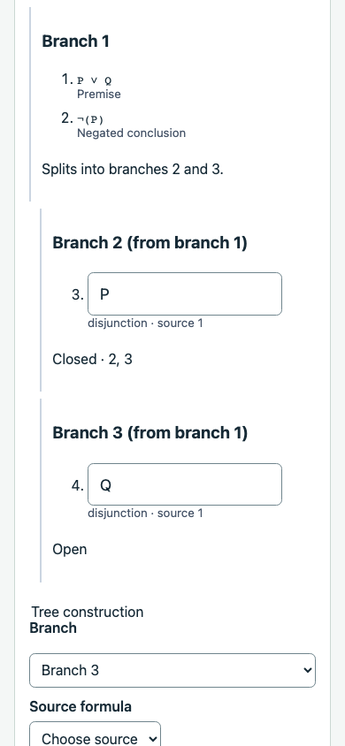

# Truth-tree foundation verification

Branch: `034-feat-semantic-tableaux`. Verified locally November 19, 2026. This records foundation verification, not full product or visual QA. Implementation decisions and slice history are in the [truth-tree plan](../planning/truth-trees.md).

## Resulting behavior

Truth trees are unsigned propositional semantic tableaux: the roots contain the premises and negated conclusion. Nine versioned decomposition rules support branching, explicit contradictory/falsity closure and completed open paths. These are separate from the retained natural-deduction tree implementation, which remains unavailable for new application work.

The deterministic checker validates identities, structure, inherited sources, rule applications and every entered error before accepting an outcome. All paths closed verifies a valid argument. A completed consistent open path verifies an invalid argument and produces a countermodel independently evaluated against the original statement. A verified counterexample may leave another path unfinished; this does not bypass checking errors already entered there. Shape/work limits and unsupported inputs produce explicit unassessable reports, not guessed scores or unsolvability claims. No proof search is implemented.

Instructor drafts retain unfinished work and private references. Publication requires a verified saved reference under the pinned versions. References, explanations, outcomes and countermodels are absent from student problem projections until separately authorized answer reveal. Completion-only assignment admission additionally requires a reference satisfying the all-path finished-attempt rule.

Student trees have per-occurrence saves, revision/lifecycle guards and explicit transient checks. Proof/tree checks stay explicit even in immediate-feedback mixed practice. Verified graded trees receive their configured points; unverified graded trees need instructor review rather than receiving zero automatically. Existing adjustment/history workflows apply. Completion permits filled, finished attempts with logical mistakes, retaining verification warnings without a correctness score. Final evidence is frozen; grade/report release and reference-answer reveal remain independent. Public `/practice/truth-trees` instead keeps work only in the page session with navigation/reset protection.

## Automated validation

- `npm run check`: workspace type checks, **2,701 tests** (836 engine, 1,185 API, 680 web) and production builds passed.
- `npm run db:test`: **321 PostgreSQL checks** (184 database, 137 API/workflow) passed. These include authoring/publication/privacy, occurrence-specific saves, transient checking, frozen finals, completion flags, grading/release, reset/isolation and historical workflow regressions.
- The three new pure demo-template tests validate both verified outcomes and finished references. A focused 19-test demo/reset/cleanup run also passed before the full database run.
- After adjusting the owner-authoring test to select its own created IDs instead of assuming no seeded truth trees, the API type check and full database suite were repeated.
- Formatting, whitespace and local Markdown file targets checked at closeout.

The first full database run exposed that seed-count assumption; it did not identify a production failure. The test now checks both authored problems' publication metadata independently of demo library contents. Earlier slice checks are documented in the implementation plan; they are not substituted for the final full runs above.

## Focused local browser evidence

Headless Chrome used temporary local Vite/API processes, real demo resource APIs and an isolated disposable PostgreSQL schema. Anonymous practice created/refuted an argument, checked explicitly without resource API calls and exercised Start over Stay/Discard. The seeded demo then exercised both examples through practice construction/check/save/reload and separate reference display, graded finalization, withheld evidence, answers before grades, later full 20/20 results, and read-only submitted work. Completion submitted one deliberately incorrect finished tree and one verified tree; student and instructor review retained the verification warning without a score.

Fixture creation was unnecessary for this final walkthrough: all problems and assignments came from the ordinary template-9 seed. Role switches, release actions and reset used API calls; student construction, checks, saves, submission and instructor review used the UI. A 390px viewport had no horizontal page overflow. Browser storage remained empty and no uncaught page errors were observed. Reset removed old assignment access. Temporary processes/schema were cleaned up. The first browser attempt stopped at an overly strict assignment-button selector; the corrected complete run passed.

Earlier focused authoring/student walkthroughs additionally covered UI publication, pending entries, failed-save retention and independent release. These are local smoke evidence, not browser CI or a visual/accessibility audit. Ignored scripts/results are under `.codex-local/verification/truth-tree-authoring/`, `truth-tree-student/` and `truth-trees-final/`; final logs use `/private/tmp/truth-tree-final-*`.

## Code-review follow-ups

Display-label helpers now use explicit cases instead of nested rendering ternaries. Closure fields and the undo dialog are controlled components; editor state, pending-work handling and tree mutations remain in the editor.

Problem types now share one `as const` enum-style object, literal-union type and Zod enum in `@logiclab/contracts/problem-type`. Schemas, UI selectors, comparisons and constructed payloads use the named values. The database re-exports the same object through its existing API and declares the internal workspace dependency. A built Node smoke verified object identity and the five unchanged wire values. Two contract regressions verify those values, unknown-type rejection and unchanged objective-only admission. Workflow-specific support remains independently guarded. The full workspace and PostgreSQL checks were repeated after this cleanup; logs use `/private/tmp/problem-type-*`. No external package or database migration was added.

The subsequent policy/role cleanup applies the same approach to assessment mode, feedback timing, solution access, grade-release timing and account roles. Each dimension keeps its own value object/type/schema, existing exports and wire values. Full schemas reuse the canonical enums; restricted practice/graded/role schemas retain their narrower sets. Persistence no longer maps validated policy values back to identical database values. Unrelated score statuses, editor purposes and relationship names are unchanged. Eight additional contract tests cover export/value compatibility, all 72 policy combinations, auth/demo role validation and authoring defaults. One integration fixture needed an explicit assessment-mode parameter type after enum defaults became literal values. Full validation and PostgreSQL checks were repeated, plus focused account-form tests; logs use `/private/tmp/policy-values-*`. No migration, package dependency or environment variable was added by this follow-up. No additional browser walkthrough was performed for these value-only refactors.

The final shared-JSON review found 34 existing database/contract types with bidirectionally assignable shapes before consolidation. Persisted proof/tree work, diagnostics/reports, instructor definitions, objective/proof results, scores and grading now reuse schema-inferred contract types through type-only exports. Additional small answer/definition/count aliases derive from their existing schemas. Storage-specific result/answer unions remain explicit because public objective-only contracts do not cover all retained proof/tree work. Entity mappings, `Date` fields, public/private projections and runtime validation remain separate.

`CheckerDiagnosticCode` now owns the 16 proof/tree diagnostic wire strings; each report schema still admits only its original code subset, and engines use named values. Billing purchase-status/class-capability definitions also share contracts values, with the simulator's narrower outcome set preserved. Five new regressions check exact diagnostic catalogs, domain-specific rejection, purchase/outcome values and the distinct covered checkout reason. Full validation and PostgreSQL regression checks were repeated; logs use `/private/tmp/shared-json-contracts-*`. No stored data, schema migration or new dependency is introduced. No further browser walkthrough was run for this consolidation.

## Demo and rollout

Template **9** adds disjunctive syllogism with closed paths and a completed open-counterexample argument. Both private references meet completion's stricter all-path requirement. Three assignments cover explicit-check practice, independently released graded work (10 points each) and score-free completion. New/reset visitors receive seven published problem versions and nine assignments, preserving the existing table/conceptual/Fitch/dependency journeys.

Authentication and role switching do not upgrade older visitors. Regression coverage constructs a template-8 graph with saved work, confirms retention until explicit reset, then verifies credential rotation, removal of old attempts, unchanged absolute expiration and another visitor's unaffected workspace.

No migration, new environment variable or external dependency is required. Rebuild/restart matching contracts, engine, database-package, API and frontend outputs. Older applications cannot consume new truth-tree definitions, tagged responses and retained result variants; coordinate rollback rather than rewriting immutable publications/results. No user development database was migrated or reset.

## Limits and next work

The editor intentionally provides baseline branch controls. The next proposed branch is `035-chore-truth-tree-practice-ui-audit`, with a dedicated checklist and visual/interaction refinement before the remaining demo teaching-flow and genuine-account audits and portfolio sandbox preparation.

No clean installation, remote CI query, hosted deployment, live Cognito/email/payment verification, load/soak run or accessibility/browser matrix was performed. Existing Jest VM-module advisories remain. No predicate tableaux, arbitrary custom tableau rules, automatic solving, autosave or browser-storage recovery is included. Completion verification flags do not automatically change completion credit. No infrastructure was provisioned, external messages sent or PR published.
